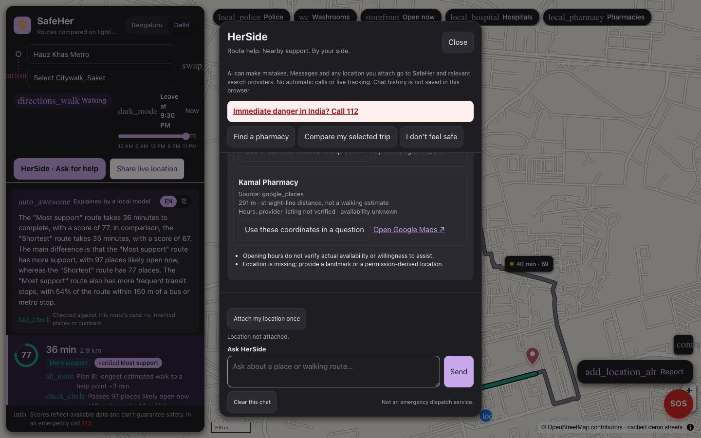

# SafeHer

**AI-powered women's safety and mobility platform** — built for the Google AI Builder Cup (Sustainability & Social Welfare).

SafeHer compares routes not just by time and distance but by **street lighting, transit access, nearby safe spaces, historical incidents and recent community reports**. Gemini explains in plain language — in your language — why one route may be preferable. Find the nearest police station, washroom or well-lit place in two taps, report hazards, and share your trip with people you trust.

> SafeHer helps you make safer, better-informed decisions. It does not guarantee safety. In an emergency, call **112**.

## Quickstart

### What you need

| | Needed for | Where to get it |
|---|---|---|
| **Python 3.11+** and ~2 GB free disk | everything | python.org or `brew install python` |
| **NASA Earthdata token** (free) | building the data (night lights) | Sign up at [urs.earthdata.nasa.gov](https://urs.earthdata.nasa.gov) → *Generate Token*. Then sign in once at [ladsweb.modaps.eosdis.nasa.gov](https://ladsweb.modaps.eosdis.nasa.gov) with the same account and accept the data licence, or downloads are redirected to the licence page. |
| Google Maps API key *(optional)* | Google basemap, search suggestions, live "open now", Google route comparison, Street View | [Google Cloud console](https://console.cloud.google.com/google/maps-apis): create a project with billing, enable **Map Tiles API, Places API (New), Routes API, Street View Static API**, create a key and restrict it to those APIs. |
| Gemini *(optional)*, either way | plain-language route explanations, and HerSide | **Recommended: Vertex AI with ADC.** Run Google's [ADC setup](https://cloud.google.com/docs/authentication/set-up-adc-local-dev-environment) (`gcloud auth application-default login`, enable the Vertex AI API), then set `GOOGLE_CLOUD_PROJECT` in `backend/.env`. No key is stored; usage is billed to your Cloud project. **Or** an AI Studio key in `GEMINI_API_KEY` ([Google AI Studio](https://aistudio.google.com/apikey); free tier has a low daily quota). |
| [Ollama](https://ollama.com) with `llama3.2:3b` *(optional)* | the **HerSide** chat companion, run locally | Install Ollama, then `ollama pull llama3.2:3b`. Settings in [backend/CHATBOT_README.md](backend/CHATBOT_README.md). |

Without the optional keys the app runs fully on open data: a CARTO basemap (OpenStreetMap data), local search, and a fact-based summary instead of Gemini's explanation. A key that **is** set but fails (wrong, out of quota, API not enabled) is shown as an error, never silently replaced.

### 1 · Install
```bash
git clone https://github.com/yadavithirwani/safeher.git && cd safeher/backend
python3 -m venv .venv && .venv/bin/pip install -e ".[dev]"
cp .env.example .env    # then paste your keys into backend/.env (gitignored; never commit it)
```

### 2 · Build the data (once, ~5–10 min)
```bash
.venv/bin/python -m safeher.data build
```
This downloads everything SafeHer needs into one file, `data/safeher.duckdb` (~145 MB, gitignored):

| Source | Download | What's kept |
|---|---|---|
| [Geofabrik](https://download.geofabrik.de/asia/india/) OpenStreetMap extracts (northern + southern zone) | ~780 MB, checksum-verified, cached in `data/raw/` | Walkable streets (Delhi ~1.0 M segments, Bengaluru ~0.6 M), 84 k places, street lamps, district boundaries |
| NASA Black Marble VNP46A4 (needs the Earthdata token) | ~380 MB, cached in `data/raw/` | Night-light brightness, ~460 m pixels, for both cities |
| NCRB crimes against women, via [India Data Portal](https://indiadataportal.com) | ~1 MB | Delhi police-district figures (public-space offences, 2019/21/22) |
| Bengaluru City Police, *Crime in Bengaluru 2023*, via [OpenCity](https://data.opencity.in) | < 1 KB | City-wide molestation and insulting-modesty cases, 2021–23 (context only: no district split is published) |

The new database is swapped in only if every check passes. Check what you have with `.venv/bin/python -m safeher.data info`; rebuild one city with `--city delhi`.

### 3 · Run
```bash
.venv/bin/uvicorn safeher.api:app --port 8765 --workers 4 --no-access-log
```
Open http://localhost:8765. Optional checks: `.venv/bin/python -m safeher.google_check` tests every Google API with your key; `.venv/bin/pytest` runs the tests (below).

Walks work anywhere inside **Delhi and Bengaluru**, up to 8 km. A trip elsewhere, or across the two cities, gets a clear message.

### Configuration
Everything city- or model-specific lives in `config/`, not in code:
- `cities.json`: supported cities (bbox, landmarks, default trip), data sources, OSM → NCRB district mapping. Add a city with one entry and a rebuild.
- `scoring.json`: the published scoring model (weights, thresholds, routing limits).
- `app.json`: app defaults (default city, departure time, trip limits, helplines, basemaps, languages).

Secrets and machine settings go in `backend/.env` (see [`.env.example`](backend/.env.example)).

## How it works


A trip is planned on a **corridor** (both points plus 1.2 km) cut from the city's data in DuckDB and cached in memory. SafeHer finds up to three distinct walking routes (shortest, most support, an alternative), adds Google's walking route when Google is on, and scores every ~50 m on five signals at your departure time:

1. **Lighting:** OSM `lit` tags and mapped lamps, NASA night lights where those are missing, else an estimate from road type
2. **Transit:** distance to bus, metro and rail stops
3. **Safe spaces:** police, hospitals, pharmacies and shops likely open at that time
4. **Historical incidents:** NCRB police-district figures in Delhi (low confidence). Bengaluru publishes only city-wide figures, shown as context but not scored
5. **Community reports:** recent reports from people using SafeHer

Each signal carries a confidence, and missing data is never scored as bad. Gemini then explains the result in plain language; its answer is fact-checked against the plan before it is shown.

More: [Architecture](docs/ARCHITECTURE.md) (data sources and the full request flow) · [Design spec](docs/DESIGN_SPEC.md) (product, scoring model, decision log).

## Current implementation guide

**[Read the end-to-end pipeline, inputs, outputs and feature status](docs/CURRENT_PIPELINE.md)** — the source of truth for what is implemented today, including the exact AI boundary, datasets, scoring, Plan B Coverage, live sharing, API contracts and limitations. [The design spec](docs/DESIGN_SPEC.md) also includes planned features; it is not an implementation checklist.

## HerSide · chat companion

Initial Google ADK supervisor/specialist agents and `POST /api/chat` are implemented, with Ollama configuration, Google Maps tools and a model-independent SOS response. **Live Ollama/ADK/Places smoke checks have passed; model reliability and Geocoding configuration still need work.** Setup, tests and limitations: [backend/CHATBOT_README.md](backend/CHATBOT_README.md). Open **HerSide · Ask for help** above the route cards for nearby-place questions, selected-trip comparisons, one-shot location attachment and SOS call options. Chat context stays in memory, not browser storage; clearing the UI does not immediately delete the expiring server context. Frontend integration is an initial version, not a production emergency service.

## Latest demo · HerSide Q&A + Plan B + live sharing

[](docs/media/safeher-demo-herside.mp4)

**[Watch the latest captioned demo](docs/media/safeher-demo-herside.mp4)** — 6:20, 1440×900, approximately 52 MB. It covers:
- Delhi walking-route comparison, transparent signals and changing departure times
- **Whole-city coverage**: switching to Bengaluru, searching any place (Toit → Bob's Bar), the night map with NASA night lights, lit streets and lamps, Bengaluru police figures as context, and the clear message outside the two cities
- Plan B estimates, coverage gaps and uncertainty
- Opt-in live sharing, recipient view, simulated movement and revoking the link
- **HerSide pre-trip Q&A powered by local Ollama**: whether extra walking time is worth better lighting evidence and fewer weak stretches
- Model-independent SOS and explicit, one-shot chatbot location consent

The pre-trip question uses a reviewed structured trip attachment, not user-typed coordinates; computed route results are not mocked. Sharing GPS is simulated and labelled. The recording uses a labelled cached OSM map. Only the latest recorder, video and poster are kept; earlier versions remain in Git history.

Recording instructions: [demo/README.md](demo/README.md).

## Features
1. Map with up to three SafeHer routes plus Google's, each scored
2. Transparent, rule-based safety score with a per-signal breakdown
3. Five data signals: lighting · transit proximity · safe spaces · historical incidents · community reports
4. Gemini route explanation in English or Hindi, fact-checked
5. Safe stops: nearest police station, washroom, hospital, pharmacy and open places
6. Plan B coverage: how far you'd be from a likely-open help point along the route
7. Community hazard reporting
8. Opt-in live location sharing (web, foreground only; expiring viewer link)
9. Night map: NASA night-light glow, lit streets and mapped street lamps
10. **HerSide** chat companion (Google ADK agents on Gemini via Vertex AI, or local Ollama): nearby help, selected-trip trade-offs, **answers about places grounded with Google Maps** (open late? busy? reviews?) with their sources, one-shot location, SOS

General multilingual Q&A and the aggregated H3 hotspot dashboard are **planned, not implemented**.

## Plan B Coverage

Route cards now show a separate **Plan B Coverage** estimate: the longest sampled walk to a potentially available help point, route share within five minutes, and clickable coverage gaps. It does not change safety scores or route ranking.

- Uses directed shortest walking-network distances to police, hospitals, pharmacies, shops and other existing support POIs; explicitly restricted-access places are excluded.
- Samples roughly every 50 m. Opening hours are checked at estimated route arrival time in minute buckets, conservatively requiring the place to remain open through the following 16-minute window. This can exclude a nearby place that closes soon.
- Missing/invalid opening hours use flagged typical-hour assumptions; mapped hours do not verify real availability or willingness to assist.
- A point-to-street connector within 100 m is a straight-line approximation, not a verified entrance or crossing. Interior edge access and travel time are estimates, not navigation instructions.
- Searches up to 15 minutes at 80 m/min. Missing or disconnected mapped coverage is shown as unknown, never zero or evidence that no help exists. Graph boundaries and incomplete POI data limit results.
- The UI lists gaps beyond five minutes and can highlight them on the map. This is not a guarantee of refuge or emergency assistance.

Tests: `cd backend && .venv/bin/pytest tests/test_backup.py`.

## Live location sharing (foreground MVP)

Click **Share live location → Start sharing**, grant browser location permission, and copy the viewer link to a trusted contact. The viewer opens a standalone map without installing an app. Only the latest GPS point, its accuracy, server receipt time, and the route selected at session creation are stored. No location history or LLM processing is involved.

- **Keep the sender page open.** Background tabs and locked phones can pause GPS/network activity. This is not native background tracking.
- Viewer polls every 5 seconds and marks updates older than 30 seconds **STALE**. It shows GPS accuracy, not guaranteed precision or a live ETA.
- Sessions expire after **two hours**. **Stop sharing** clears GPS tracking and deletes the session. If revocation fails offline, the UI warns and lets you retry; the server retains the last point until expiry.
- Reload recovery stores owner credentials in the sender tab’s session storage; resuming GPS requires an explicit click. Closing the tab does not immediately revoke a link. Stop before closing.
- Separate random owner/viewer credentials; only hashed credentials are stored in SQLite (`backend/var/safeher.sqlite3`). Anyone holding a viewer link can view it. Do not publish links or log request paths. Use `--no-access-log`; production proxies/APM must also redact `/api/trips/*` paths and request bodies.
- Expired data is purged at most a minute after expiry while the server runs, and on subsequent database access. Stopped data is deleted immediately; secure deletion is enabled. Database backups or recipient screenshots are outside this prototype’s deletion control.
- GPS works on **localhost or HTTPS**. A localhost link works only on this computer: phone/contact testing needs a reachable HTTPS deployment. Do not use an HTTP LAN IP for GPS.
- Public deployment still needs per-client abuse/rate controls, HTTPS, security review, and device testing. The prototype caps active sessions at 1,000 but is not production-hardened.
- No automatic arrival detection, trusted-contact delivery, SMS, or background-location support yet. Map rendering uses external basemap/CDN services; live GPS is sent only to the SafeHer backend, but map tile providers can infer the viewed area.

Run isolated API regressions from `backend/`: `.venv/bin/pytest tests/test_trips.py`.

### Local Ollama explanations

Explanations can come from a local Ollama model instead of Gemini:

```bash
ollama list   # e.g. llama3:latest
SAFEHER_LLM=ollama OLLAMA_MODEL=llama3:latest .venv/bin/uvicorn safeher.api:app --port 8765 --no-access-log
```

Or set `SAFEHER_LLM=ollama` and `OLLAMA_MODEL` in `backend/.env`. Answers go through the same fact checks; if the model is unavailable or fails the checks twice, the app shows an error (no silent fallback). No Gemini calls are made in Ollama mode, and prompts include planned-route facts only, never live GPS.

## Tests
From `backend/`: `.venv/bin/pytest` runs about 300 tests: unit, API, data integrity, random trips across both cities, fuzzing, and the web app in headless Chromium (run `.venv/bin/python -m playwright install chromium` once). Tests that need the data skip until it's built, and real API keys are hidden from tests unless `SAFEHER_LIVE_GOOGLE=1`.

HerSide's browser tests run separately: `RUN_BROWSER_TESTS=1 .venv/bin/pytest tests/test_chatbot_ui.py`. Heavier runs: `SAFEHER_FUZZ_EXAMPLES=1000 .venv/bin/pytest tests/test_fuzz.py`, `SAFEHER_SEED=<n> SAFEHER_TRIPS=5 .venv/bin/pytest tests/test_random_trips.py`. Load test against a running server: `.venv/bin/python -m tests.tools.load_test --users 40 --seconds 60`.

### Record the demo video
With SafeHer and Ollama running, from the repository root: `backend/.venv/bin/python demo/record_demo.py --base http://localhost:8765` → `docs/media/safeher-demo-herside.mp4`. Requires Chrome, ffmpeg and cached MapLibre assets; see [demo/README.md](demo/README.md). Add `--headed` to watch.

## Planned stack
Flutter · Google Maps Platform (Maps SDK, Routes, Places) · Gemini API / Vertex AI · Firebase (Auth, Firestore, FCM) · Cloud Run · BigQuery GIS

## Repo layout
```
app/web/     web app (MapLibre), served by the API
backend/     FastAPI backend: data build, routing, scoring, Gemini, reports, live sharing, tests
config/      cities, scoring model and app defaults (JSON)
data/        safeher.duckdb and raw downloads (built locally, gitignored)
demo/        Playwright demo recorders
docs/        design spec, architecture diagrams, demo videos
dashboard/   community / authority dashboard (planned)
```

## Team
Built by the SafeHer team for the Google AI Builder Cup 2026.
