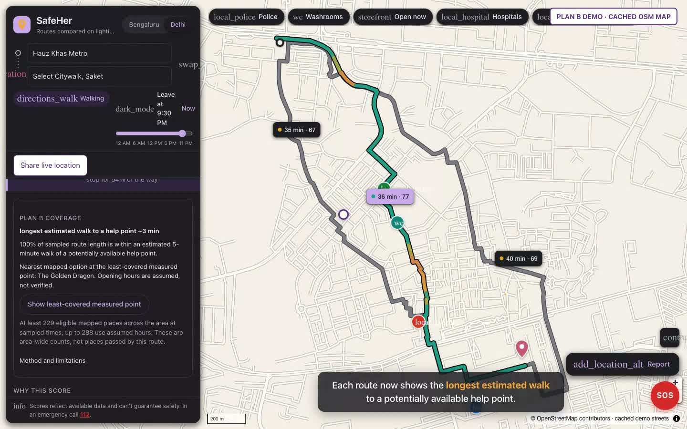

# SafeHer

**AI-powered women's safety and mobility platform** — built for the Google AI Builder Cup (Sustainability & Social Welfare).

SafeHer compares routes not just by time and distance but by **street lighting, transit access, nearby safe spaces, historical incidents and recent community reports**. Gemini explains in plain language — in your language — why one route may be preferable. Find the nearest police station, washroom or well-lit place in two taps, report hazards, and share your trip with people you trust.

> SafeHer helps you make safer, better-informed decisions. It does not guarantee safety. In an emergency, call **112**.

## Demo

[](docs/media/safeher-demo.mp4)

▶️ **[Watch the 2½-minute demo video](docs/media/safeher-demo.mp4)** (MP4, 8.7 MB, captioned). It shows:
- Night-time route comparison in Delhi: the best-supported route is slightly longer and scores higher than the shortest
- Weak stretches, safe stops and the per-signal breakdown
- Scores changing with time of day (1 PM vs 11:45 PM)
- Nearest police and washrooms, and how the score is calculated
- Bengaluru's street lamps on the night map, reporting and SOS

## Demo · Plan B Coverage + live sharing

[](docs/media/safeher-demo-plan-b-and-live-sharing.mp4)

**[Watch the Plan B + live sharing demo](docs/media/safeher-demo-plan-b-and-live-sharing.mp4)**: the walkthrough plus a live-sharing chapter, then Plan B route comparisons, departure-time changes, coverage-gap highlighting and least-covered-point focus. It uses real API calculations and a labelled cached OSM map.

## Plan B Coverage

Route cards now show a separate **Plan B Coverage** estimate: the longest sampled walk to a potentially available help point, route share within five minutes, and clickable coverage gaps. It does not change safety scores or route ranking.

- Uses directed shortest walking-network distances to police, hospitals, pharmacies, shops and other existing support POIs; explicitly restricted-access places are excluded.
- Samples roughly every 50 m. Opening hours are checked at estimated route arrival time in minute buckets, conservatively requiring the place to remain open through the following 16-minute window. This can exclude a nearby place that closes soon.
- Missing/invalid opening hours use flagged typical-hour assumptions; mapped hours do not verify real availability or willingness to assist.
- A point-to-street connector within 100 m is a straight-line approximation, not a verified entrance or crossing. Interior edge access and travel time are estimates, not navigation instructions.
- Searches up to 15 minutes at 80 m/min. Missing or disconnected mapped coverage is shown as unknown, never zero or evidence that no help exists. Graph boundaries and incomplete POI data limit results.
- The UI lists gaps beyond five minutes and can highlight them on the map. This is not a guarantee of refuge or emergency assistance.

Tests: `cd backend && .venv/bin/pytest tests/test_backup.py`.

## MVP features
1. Map with 2–3 candidate routes
2. Transparent, rule-based safety score
3. Five data signals: lighting · transit proximity · verified safe spaces · historical anonymised incidents · recent community reports
4. Gemini route explanation and multilingual Q&A
5. Safe stops: nearest police station, closest washroom, well-lit places along the route
6. Community hazard reporting
7. Opt-in live location sharing (web foreground-only; expiring viewer link)
8. Aggregated, privacy-preserving hotspot dashboard

## Run the demo
```bash
cd backend
python3 -m venv .venv && .venv/bin/pip install -e ".[dev]"
.venv/bin/uvicorn safeher.api:app --port 8765 --workers 4 --no-access-log
```
Open http://localhost:8765.

Settings live in `config/`: demo areas and landmarks (`areas.json`), the published scoring model (`scoring.json`) and app defaults such as the opening time and helplines (`app.json`). Add an area by adding an entry to `areas.json` and running `.venv/bin/python -m safeher.fetch <area-id>`.

**Google Maps Platform (optional).** Put `GOOGLE_MAPS_API_KEY=...` in `backend/.env` (Cloud project with billing; enable Map Tiles API, Places API (New), Routes API, Street View Static API) to switch on the Google basemap, Google search, live "open now", Google route comparison and Street View. Check every API with `.venv/bin/python -m safeher.google_check`. Without a key everything runs on open data.

Route explanations use **Gemini** when `GEMINI_API_KEY=...` is set in `backend/.env` (free key from [Google AI Studio](https://aistudio.google.com/apikey); never commit it). Without a key, a fact-checked template is used. Map data for both demo areas is already in `data/areas/`; rebuild it with `.venv/bin/python -m safeher.fetch`. Run the tests with `.venv/bin/pytest`.

### Tests
From `backend/`: `.venv/bin/pytest` (unit, API, data integrity, random trips, fuzzing). Heavier runs: `SAFEHER_FUZZ_EXAMPLES=1000 .venv/bin/pytest tests/test_fuzz.py`, `SAFEHER_SEED=<n> SAFEHER_TRIPS=5 .venv/bin/pytest tests/test_random_trips.py`. Load test against a running server: `.venv/bin/python -m tests.tools.load_test --users 40 --seconds 60`.

### Record the demo video
With the server running: `backend/.venv/bin/python -m playwright install chromium` (once), then `backend/.venv/bin/python demo/record_demo.py` → `demo/out/safeher-demo.mp4` (≈2½ min, captioned). Add `--headed` to watch it record.

## Live location sharing (foreground MVP)

Click **Share live location → Start sharing**, grant browser location permission, and copy the viewer link to a trusted contact. The viewer opens a standalone map without installing an app. Only the latest GPS point, its accuracy, server receipt time, and the route selected at session creation are stored. No location history or LLM processing is involved.

- **Keep the sender page open.** Background tabs and locked phones can pause GPS/network activity. This is not native background tracking.
- Viewer polls every 5 seconds and marks updates older than 30 seconds **STALE**. It shows GPS accuracy, not guaranteed precision or a live ETA.
- Sessions expire after **two hours**. **Stop sharing** clears GPS tracking and deletes the session. If revocation fails offline, the UI warns and lets you retry; the server retains the last point until expiry.
- Reload recovery stores owner credentials in the sender tab’s session storage; resuming GPS requires an explicit click. Closing the tab does not immediately revoke a link. Stop before closing.
- Separate random owner/viewer credentials; only hashed credentials are stored in SQLite (`backend/var/trips.sqlite3`). Anyone holding a viewer link can view it. Do not publish links or log request paths. Use `--no-access-log`; production proxies/APM must also redact `/api/trips/*` paths and request bodies.
- Expired data is purged at most a minute after expiry while the server runs, and on subsequent database access. Stopped data is deleted immediately; secure deletion is enabled. Database backups or recipient screenshots are outside this prototype’s deletion control.
- GPS works on **localhost or HTTPS**. A localhost link works only on this computer: phone/contact testing needs a reachable HTTPS deployment. Do not use an HTTP LAN IP for GPS.
- Public deployment still needs per-client abuse/rate controls, HTTPS, security review, and device testing. The prototype caps active sessions at 1,000 but is not production-hardened.
- No automatic arrival detection, trusted-contact delivery, SMS, or background-location support yet. Map rendering uses external basemap/CDN services; live GPS is sent only to the SafeHer backend, but map tile providers can infer the viewed area.

Run isolated API regressions from `backend/`: `.venv/bin/pytest tests/test_trips.py`.

### Local Ollama explanations

Ollama is supported independently of sharing. With Ollama running locally and a model installed:

```bash
# Already installed on the development machine: llama3:latest
ollama list
SAFEHER_LLM=ollama OLLAMA_MODEL=llama3:latest .venv/bin/uvicorn safeher.api:app --port 8765 --no-access-log
```

Alternatively set `SAFEHER_LLM=ollama` and `OLLAMA_MODEL=llama3:latest` in the ignored `backend/.env`. Explanations are validated; rejected/unavailable model answers fall back to the deterministic template. No Gemini calls are made in Ollama mode. Model prompts include planned-route facts, not live GPS updates.

## Docs
- [Design spec](docs/DESIGN_SPEC.md)

## Planned stack
Flutter · Google Maps Platform (Maps SDK, Routes, Places) · Gemini API / Vertex AI · Firebase (Auth, Firestore, FCM) · Cloud Run · BigQuery GIS

## Repo layout
```
app/web/    demo web app (MapLibre, served by the API)
dashboard/  community / authority dashboard (web)
backend/    Cloud Run API (scoring, Gemini, reports, trips)
data/       ingestion scripts and pilot-city datasets
docs/       design spec and decisions
```

## Team
Built by the SafeHer team for the Google AI Builder Cup 2026.
