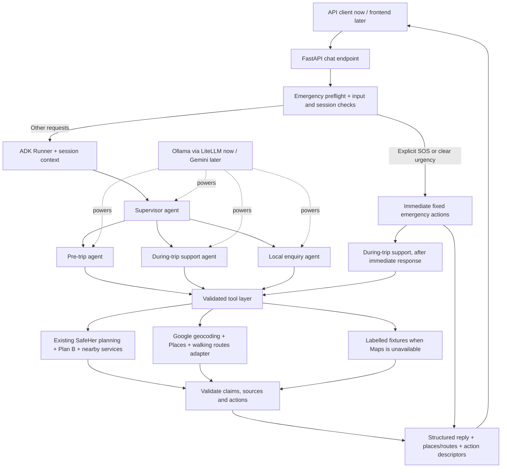

# SafeHer Companion — backend architecture draft

**Status: proposed, not implemented.** Backend only; frontend integration comes later. Working name: **SafeHer Companion**, with an SOS mode. This assistant helps find evidence-backed options; it is not an emergency dispatcher or a guarantee of safety.

Existing application: [current pipeline](../docs/CURRENT_PIPELINE.md).

## 1. Can we use Google ADK with Ollama first?

**Yes.** Use Google's Python Agent Development Kit (ADK) with its `LiteLlm` adapter and an Ollama **tool-capable** model. Later, select ADK's native Gemini adapter without rewriting the tools or agent responsibilities.

- Ollama identifier: `ollama_chat/<model-name>`, not `ollama/<model-name>`; ADK documents tool-loop/context issues with the latter.
- Local endpoint: normally `http://localhost:11434`; configure `OLLAMA_API_BASE` for the adapter.
- Verify `ollama show <model>` advertises `tools`. Existing `llama3:latest` must not be assumed suitable. Select and test a supported model before implementing the agent team.
- Capability support is only a prerequisite: test argument extraction, tool calls, handoffs, English/Hindi behavior and loop recovery. Local model performance is not guaranteed to match Gemini.
- Put model selection behind one configuration point, applied to supervisor and specialists. Switching to Gemini later still requires regression tests.
- ADK itself does not require a Gemini key when using this local configuration. Installing the LiteLLM integration will be a development step, not part of this draft.

**Separate credentials:** Gemini access and Google Maps Platform access are different. Maps needs its own configured/restricted credentials, enabled APIs and billing. An Ollama backend can call Maps without Gemini. If we have neither key, start with existing SafeHer data and labelled Maps fixtures; real Maps integration remains untested until credentials exist.

## 2. Initial scope

| Agent | Example query | Job |
|---|---|---|
| Supervisor | Any supported message | Understand intent, ask essential clarifications, delegate; handle mixed intents with urgency first. |
| Pre-trip agent | “I need to go from A to home tonight. Which route?” | Resolve endpoints/time/preferences, compare routes, explain evidence and trade-offs. |
| During-trip support agent | “I don't feel safe. I'm here—what can I do?” | Prioritize emergency actions, establish usable location, find relevant nearby assistance. |
| Local enquiry agent | “Where's the nearest pharmacy?” | Search places and details, assess walking access/hours, return actionable options. |

General enquiry initially means **local places and SafeHer capabilities**, not unlimited medical/legal advice or open-web questions. Outside-scope requests get a clear limitation.

Use one supervisor plus these three specialists. No agent per place category, no vector database, no separate microservices, no MCP requirement for the first version. Specialists reuse ordinary typed Python tools.

## 3. Architecture

Emergency preflight is application logic **before** model execution. ADK owns the subsequent conversation and tool orchestration. An urgent response must be returned immediately; optional enrichment can follow in a later turn. It must not wait for a slow model or Maps call.

## 4. Agent behavior

### Supervisor

Use Python ADK `sub_agents` with narrow descriptions/instructions. Delegation is LLM-driven; it is not a guaranteed safety classifier. Explicit SOS/clear urgency bypasses it. A during-trip agent can handle an ordinary pharmacy request, too; being on a trip does not make every message an emergency.

Each turn rechecks urgency before dispatch. Handle topic changes explicitly so an earlier handoff cannot trap later messages in the wrong specialist. Limit handoffs and total tool calls per turn; stop on repeated identical calls and return a useful fallback.

### Pre-trip

1. Resolve origin and destination. “Home” requires a user-provided address for this session; no guessed home location or persistent home profile in MVP.
2. Resolve departure date/time/timezone and walking preferences. “Tonight” may need clarification; a clock time alone is insufficient near midnight.
3. Geocode ambiguous names and ask the user to select a match. Never choose a city silently.
4. In supported pilots, call SafeHer planning for candidate routes and signal breakdowns: lighting evidence, expected-open places, transit proximity, community reports, historical-data limitations, weak stretches and Plan B gaps.
5. Consider duration, distance, acceptable detour and hours around estimated arrival. Current standard scores use departure-time hours; do not describe them as arrival-aware. Plan B already has separate arrival-time checks.
6. Return a small comparison with reasons and uncertainties, not “the safest route.” Preferences affect selection transparently, not secretly rewrite the support score.

Google can improve destination discovery and walking estimates. Google geometry **does not automatically have a SafeHer score**. MVP keeps scored routes from our graph; Google routes outside the pilots are unscored navigation options. No fabricated lighting/crime/Plan B coverage outside available data.

### During-trip support / SOS

- For explicit SOS or apparent immediate danger, return the configured local emergency call action first. Initial deployment is India: **112**. Do not present it as a worldwide number.
- Keep wording brief, calm and nonjudgmental. Do not demand a narrative before offering emergency options.
- If location is missing, offer a location-request action or ask for a landmark; if old/inaccurate, disclose that and request an update without withholding emergency actions.
- Search police/hospitals and potentially open public-facing places as appropriate. Present distance basis, hours/source and directions options; police stations need not be the closest or most accessible option.
- Do not direct a person to confront someone, promise rescue, assert a place is safe, or infer a building entrance from a coordinate.
- Calling/navigation are action descriptors for a client to execute after user choice. The backend does not place calls, notify police, or start live sharing.

Preflight can use explicit emergency flags and conservative phrase rules, but cannot detect every urgent situation. Agents must also recognize urgency and escalate. Model/provider failure must never suppress the fixed emergency response.

### Local enquiry

Resolve category, search anchor (“here,” destination, map point) and time. Return up to three real results. Distinguish “closest by straight-line distance” from “shortest estimated walk.” Ask an essential clarification rather than inventing missing context. Opening hours are listed/assumed/unknown, not a guarantee someone is available.

## 5. Tool scope and data sources

Names below are proposed Python interfaces, not existing endpoints.

| Tool | Source | Contract / limit |
|---|---|---|
| `resolve_location` | Google Geocoding; existing landmarks/POIs as limited fallback | Return candidates with coordinates and source; no model-memory geocoding. |
| `plan_supported_trip` | Existing `plan.py` | Pilot-only scores, breakdowns, weak stretches, stops and Plan B; no AI arithmetic. |
| `search_nearby_places` | Google Places or existing nearby logic | Category, anchor, search radius, hours evidence and distance basis. Existing local search is straight-line. |
| `get_place_details` | Google Places | Available address, phone, opening-hours evidence and attribution; details can be missing. |
| `estimate_walking_access` | Google Routes walking support where available | Duration/distance or explicit unavailable result; do not silently substitute driving. |
| `get_plan_b_coverage` | Existing computed route result | Return selected route's gaps/help-access estimates; do not recalculate via an LLM. |
| `get_emergency_actions` | Static jurisdiction configuration | Validated call actions; available without a model or location fix. |

Reuse backend service functions rather than making loopback HTTP calls to our own server. Tools validate coordinates, enums, radius, IDs and time; models do not get arbitrary URL access or unrestricted SQL. Tool output is untrusted data, never new agent instructions.

**Google considerations:** enable only required APIs, keep credentials server-side, restrict keys appropriately, and enforce quotas/timeouts. Review current attribution, caching and map-display terms before storing/displaying Google results on our MapLibre frontend. Do not persist full Google place responses by default. Retain provider attribution required for later rendering.

## 6. Backend API and conversation context

Proposed endpoint: **`POST /api/chat`**, JSON first, no streaming requirement for MVP.

**Input:** message, optional server-issued session ID, explicit SOS flag, optional permission-derived location with accuracy/timestamp, selected route/trip reference, departure time and language. An emergency flag is additive; its absence does not mean a message is nonurgent.

**Output:** reply, intent, urgency, places/routes, source timestamps, warnings, and typed actions such as `call`, `request_location`, `show_place`, `open_directions`. Include `needs_clarification` when appropriate. Actions/coordinates/phone numbers come from validated tools/configuration, never unchecked prose.

Use ADK Runner and short-lived sessions. Store only needed context: confirmed endpoints, departure, latest voluntarily supplied location, selected route and recent dialogue. Route/trip references require authorization; possession of a chat session ID must not grant access to another user's live trip. Sessions must be isolated and expire. Do not log raw precise locations, addresses, messages or capability tokens by default. No persistent home address or transcript store in MVP.

There is no frontend browser GPS or call execution in this phase. Curl/tests supply explicit locations; later the client will request permission and display/execute allowed actions.

## 7. Guardrails and failure behavior

- AI handles intent, clarification, delegation and grounded summaries. Deterministic code handles geometry, scoring, permissions, expiry and emergency numbers.
- Missing/stale GPS: disclose; request a better anchor. Maps/model timeout: short bounded response, existing local fallback where valid, no invented results.
- No local data outside pilots: say so. Fixtures must always be marked **test data**, never presented as real nearby assistance.
- Fixed budgets for latency, handoffs and tool calls; no autonomous retry loops. Final-response checks ensure place references/actions match actual tool records; failed checks return a safe structured fallback.
- English/Hindi initially, subject to model evaluation. No voice, automatic outreach, continuous tracking, autonomous dispatch or guaranteed safety classification.
- Local Ollama means local model inference; Google tool calls still send location/query data externally. Gemini later also receives the selected chat/tool context. Minimize what is sent and disclose this before client integration.

## 8. Development sequence and acceptance checks

1. **Local feasibility:** pin compatible ADK/LiteLLM versions in the project environment; choose a tool-capable Ollama model; test tool calling and specialist handoffs with fixtures.
2. **Backend MVP:** endpoint, emergency fast path, isolated expiring sessions, three specialists and shared SafeHer tool wrappers. Add Maps adapter behind configuration; retain explicit fixtures/fallbacks without a key.
3. **Real-provider testing:** enable Maps credentials and verify actual results, walking support, quotas and failure handling. Switch to Gemini when available; rerun the same assertions.
4. **Frontend later:** chat UI, user-consented location, markers, call/directions actions and privacy disclosure.

Acceptance scenarios: pre-trip route comparison; ambiguous “home”; pharmacy with no anchor; expected-open pharmacy near destination; urgent message while in another specialist; missing/stale GPS; Maps/model failure; unsupported area; injected instructions in tool data; looping model; invalid action; expired/foreign session; English/Hindi requests. Assert correct tool arguments and source-grounded results, not exact model wording. Emergency fast-path tests must pass with all external services disabled.

## 9. Defaults for review

- Name: **SafeHer Companion** (SOS is a mode).
- India, walking, existing pilot-area scoring, English/Hindi first.
- Ollama initially; Gemini later; Maps credentials independent and optional for local tests.
- Backend architecture/documentation now; no chatbot code, dependencies or frontend changes in this draft.

Official references checked for this draft:
- [ADK Ollama](https://adk.dev/agents/models/ollama/)
- [ADK LiteLLM](https://adk.dev/agents/models/litellm/)
- [ADK Python agent teams](https://adk.dev/tutorials/agent-team/)
- [ADK Gemini](https://adk.dev/agents/models/google-gemini/)
- [Google Maps API security](https://developers.google.com/maps/api-security-best-practices)
- [Google Maps billing](https://developers.google.com/maps/billing-and-pricing/overview)
