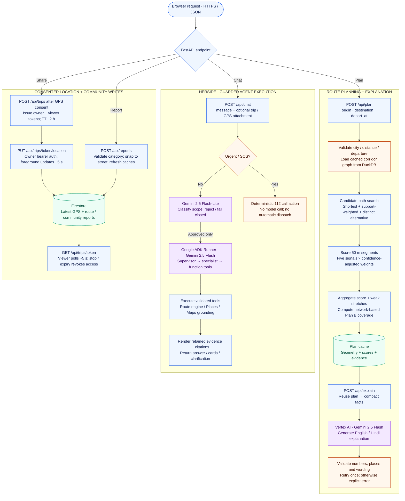

# SafeHer Architecture

Where every piece of data comes from, how it is handled, and what happens between the browser and the backend for one trip. The full page with both diagrams and the source table is [architecture/architecture.html](architecture/architecture.html) (open it in a browser). The diagrams are generated by [architecture/build.py](architecture/build.py): edit that file and run `python3 docs/architecture/build.py` rather than editing the SVGs.

In short: **one read-only reference database** built by one command, **one small database** for what people create, and **live calls** only for Google Maps and Gemini.

## 1 · Data sources and how each is handled

Four sources are fetched once by the build pipeline into `data/safeher.duckdb`; the backend reads only a trip's corridor from it. Google Maps and Gemini are called per request and nothing they return is kept. Reports and live-sharing sessions are the only data written while the app runs, into SQLite (`backend/var/safeher.sqlite3`), which handles several server workers writing at once.

| Source | Fetched | Key | Refresh | Stored in | Used for |
|---|---|---|---|---|---|
| OpenStreetMap (Geofabrik) | Build | None | On rebuild (daily extracts) | `segments`, `places`, `districts` | Walking network, lit streets and lamps (scored and drawn), open places, search, district lookup |
| NASA Black Marble VNP46A4 | Build | Earthdata token | Yearly product | `night_lights` | Measured lighting where OSM has no tags or lamps; the night-glow map layer (areas, not single lamps) |
| NCRB · India Data Portal | Build | None | Yearly (latest: 2022) | `incidents` | Delhi police-district figure for each point on a route, low confidence |
| Bengaluru City Police · OpenCity | Build | None | Yearly (latest: 2023) | `city_stats` | City-wide figures shown as context on Bengaluru trips; never scored (no district split) |
| Google Maps Platform | Live | API key | Every request | Nothing (place IDs only) | Map, search, open-now, comparison route, Street View |
| Gemini (Vertex AI) | Live | ADC (Cloud project) | Every new trip / question | Nothing | Plain-language explanation after fact checks; HerSide agents; answers about places **grounded with Google Maps**, shown with their Google Maps sources |
| People using SafeHer | Live | None | As they use it | `safeher.sqlite3` | Community reports, live-sharing sessions |

## 2 · One trip, from the browser to the backend and back

Solid arrows are requests, dashed arrows are replies. The plan is cached, so the explanation reuses it instead of planning again, and a new report refreshes it.

## Rules the flow follows

- **No silent fallbacks.** If a configured key fails, or Gemini's answer fails the fact checks twice, the request returns an error with the reason. A key that isn't set simply turns that feature off.
- **Google content only on a Google map.** Places and Routes results appear only when the Google basemap is on, as Google's terms require.
- **Keys stay on the server.** Map tiles and Street View images pass through the backend without being cached.
- **Scores come from SafeHer's rules.** Google's route is scored by the same engine as SafeHer's own routes; Gemini only puts the results into words.
- **Supported cities only.** Delhi and Bengaluru are built locally; a trip elsewhere, across cities or over 8 km gets a clear message. Adding a city is one entry in `config/cities.json` plus the build command.

## Code map

| Where | What |
|---|---|
| `backend/safeher/data.py` | The build: `python -m safeher.data build` downloads, filters, validates and swaps in `data/safeher.duckdb` |
| `backend/safeher/store.py` | Read-only DuckDB access; builds trip corridors (walking graph + places) in memory, LRU-cached |
| `backend/safeher/cities.py` | Supported cities and corridors; refuses trips outside them |
| `backend/safeher/routing.py`, `plan.py` | Candidate routes (shortest, most support, distinct alternative) and per-50 m scoring |
| `backend/safeher/signals.py`, `scoring.py` | The five signals and the published scoring model (`config/scoring.json`) |
| `backend/safeher/backup.py` | Plan B coverage: walking time to a likely-open help point along the route |
| `backend/safeher/explain.py` | Facts → Gemini (or Ollama) → fact checks; template when no model is configured |
| `backend/safeher/search.py` | City-wide place, neighbourhood and street search |
| `backend/safeher/google.py` | Google Maps Platform client (tiles, Places, Routes, Street View) |
| `backend/safeher/userdb.py`, `trips.py` | SQLite for reports and live sharing |
| `backend/safeher/chatbot/` | **HerSide** chat companion (Anushka): Google ADK supervisor and specialist agents on Ollama or Gemini, validated tools (Google Places/Routes first, city-wide OSM data as fallback), SOS fast path. Details: [backend/CHATBOT_README.md](../backend/CHATBOT_README.md), [CURRENT_PIPELINE.md §6](CURRENT_PIPELINE.md) |
| `backend/safeher/api.py` | FastAPI endpoints (including `POST /api/chat`) and the web app |
| `app/web/` | The web app (MapLibre): `app.js` map and routes, `sharing.js`/`live.js` live sharing, `backup.js` Plan B, `chatbot.js` HerSide |
| `config/` | `cities.json` (cities and data sources), `scoring.json` (scoring model), `app.json` (app defaults) |

Design decisions and their reasons are in the [design spec](DESIGN_SPEC.md), §8.13 and the decision log (§16).

## 3 · Runtime process flow — requests, computation and persistence

Three execution paths show API contracts, deterministic computation, model calls and user-data writes. This is a runtime flow, not a feature map. Purple marks model execution; cylinders mark stored state.

**Reading the flow:** HerSide, nearby help, sharing, reporting and SOS can also be used independently of route planning. SafeHer computes the scores; Gemini explains the evidence. Sharing is opt-in and foreground-only; SOS opens a user-initiated call, not automatic dispatch.

## 4 · Technical solution architecture — service and deployment boundaries

The Cloud Run boundary contains the FastAPI services and ADK runtime; Vertex AI is an external managed inference service. HerSide uses a **hierarchical, tool-using multi-agent team**: a supervisor delegates to one of three specialists through ADK's `transfer_to_agent` mechanism. This is model-directed delegation, not a fixed sequence or a parallel-agent workflow. Solid arrows show runtime calls, control transfers and data access; dashed arrows show deployment or secret injection. Component labels map to implementation modules.

```mermaid
flowchart TB
    BROWSER["Browser · MapLibre GL JS<br/>Route UI / HerSide / GPS sender / live viewer"]
    HOST["Firebase Hosting · HTTPS<br/>Static assets + /api/** rewrite"]
    BROWSER -->|"HTTPS / JSON"| HOST

    subgraph CLOUD["CLOUD RUN · asia-south1 · Docker / Python 3.12 / Uvicorn"]
        API["FastAPI + Pydantic<br/>Request validation / API routers"]
        ENGINE["routing.py / plan.py / scoring.py<br/>Graph search + confidence-weighted scoring"]
        PLANB["backup.py<br/>Network shortest-distance help coverage"]
        EXPLAIN["explain.py<br/>Fact extraction + output validation"]
        MAPCLIENT["Maps adapters · httpx<br/>google.py / chatbot/maps.py"]
        USERDB["userdb.py / trips.py<br/>Reports + capability-authorized live sessions"]
        MEMORY[("Process-local state<br/>Plan / corridor caches + chat TTL")]

        subgraph ADK["HERSIDE · GOOGLE ADK · agents.py / service.py / tools.py"]
            GUARD["service.py · request guard<br/>Urgency check before session lock or model calls"]
            SOS["Deterministic emergency response<br/>112 call action; no automatic dispatch"]
            SCOPE["scope.py · safety-topic gate<br/>Reject off-topic; fail closed if unavailable"]
            CONTEXT["service.py · turn context<br/>Recent dialogue + language + current time<br/>Confirmed trip / fresh consented GPS only"]
            RUNNER["ADK Runner · run_async<br/>Fresh InMemorySessionService per turn<br/>60 s timeout; max_llm_calls = 6"]
            SUP["supervisor · dispatcher Agent<br/>Reads current request; delegates via transfer_to_agent<br/>Own tools: clarification + emergency actions"]

            subgraph TEAM["SPECIALIST AGENTS · task-specific instructions + tool allowlists"]
                PRE["pre_trip<br/>Future walks / route trade-offs / Plan B"]
                DURING["during_trip<br/>Walking concerns / nearby assistance"]
                LOCAL["local_enquiry<br/>Nearby places / details / safety-related place context"]
            end

            BUDGET["before_tool_callback · budget<br/>Check coordinate types; record transfer intent<br/>Max 8 tool calls including transfers; block repeats"]
            ROUTETOOLS["Route tools<br/>compare_selected_trip / plan_supported_trip<br/>get_plan_b_coverage"]
            PLACETOOLS["Place + access tools<br/>resolve_location / search_near_current_location<br/>search_nearby_places / get_place_details<br/>estimate_walking_access"]
            GROUNDTOOL["Grounded context tool<br/>ask_google_maps"]
            CONTROL["Control tools<br/>ask_clarification / get_emergency_actions"]
            STATE[("ADK ToolContext.state · turn:*<br/>Confirmed inputs / intent / call budget<br/>Retained evidence / clarification / emergency flag")]
            RENDER["tools.py · render_evidence<br/>Assemble reply / cards / actions / sources<br/>Not the agent's final prose; clarify if no evidence"]
            RESPONSE["ChatResponse → API → browser<br/>Delete ADK session in finally"]

            GUARD -->|"Urgent: bypass ADK"| SOS
            GUARD -->|"Non-urgent"| SCOPE
            SCOPE -->|"Approved only"| CONTEXT --> RUNNER --> SUP
            SUP -->|"transfer_to_agent: pre_trip"| PRE
            SUP -->|"transfer_to_agent: during_trip"| DURING
            SUP -->|"transfer_to_agent: local_enquiry"| LOCAL
            SUP -->|"Own tool calls"| BUDGET
            PRE --> BUDGET
            DURING --> BUDGET
            LOCAL --> BUDGET
            BUDGET -->|"Allowed by calling agent's tool set"| ROUTETOOLS
            BUDGET --> PLACETOOLS
            BUDGET --> GROUNDTOOL
            BUDGET --> CONTROL
            CONTEXT -->|"Seed confirmed input state"| STATE
            BUDGET -->|"Track calls + intent"| STATE
            ROUTETOOLS -->|"Retain results"| STATE
            PLACETOOLS -->|"Retain results"| STATE
            GROUNDTOOL -->|"Retain answer + attribution"| STATE
            CONTROL -->|"Set clarification / emergency"| STATE
            STATE -->|"Tool results inform subsequent model steps"| RUNNER
            STATE -->|"After run: render evidence or emergency response"| RENDER
            RENDER --> RESPONSE
            SOS --> RESPONSE
        end

        API --> ENGINE --> PLANB
        API --> EXPLAIN
        API --> GUARD
        API --> MAPCLIENT
        API --> USERDB
        ENGINE --> MEMORY
        CONTEXT -->|"Read recent dialogue; refresh 30 min TTL"| MEMORY
        ROUTETOOLS -->|"Plan / Plan B"| ENGINE
        PLACETOOLS -->|"Place / walking lookup"| MAPCLIENT
    end

    subgraph VERTEX["VERTEX AI · global · SERVICE-ACCOUNT ADC"]
        FLASH["Gemini 2.5 Flash<br/>ADK inference + route explanations"]
        LITE["Gemini 2.5 Flash-Lite<br/>Safety-topic classification"]
        GROUND["Gemini 2.5 Flash + googleMaps tool<br/>Grounded place context + source metadata"]
    end

    subgraph DATA["DATA + EXTERNAL APIS"]
        DUCK[("DuckDB · read-only in image<br/>Segments / POIs / lights / district incidents")]
        FIRE[("Firestore Native<br/>Reports / trips + expire_at TTL")]
        MAPS["Google Maps Platform · REST<br/>Tiles / Places / Routes / Street View / Geocoding"]
        BUILD["Offline ETL · data.py<br/>OSM + VIIRS + NCRB + police context"]
        BUILD -->|"Validate + atomic replace"| DUCK
    end

    subgraph OPS["DELIVERY + SECRETS"]
        CI["GitHub Actions · federated identity<br/>pytest + Playwright → Cloud Build / Registry"]
        SECRET["Secret Manager<br/>Server-side Maps API key"]
    end

    HOST -->|"API rewrite"| API
    ENGINE -->|"Read corridor"| DUCK
    EXPLAIN -->|"generateContent: plan facts"| FLASH
    RUNNER -->|"Supervisor + specialist model inference"| FLASH
    SCOPE -->|"Scope classification"| LITE
    GROUNDTOOL -->|"grounding.py: generateContent"| GROUND
    MAPCLIENT -->|"Server-side HTTPS"| MAPS
    USERDB -->|"Read / write; enforce expiry"| FIRE
    CI -.->|"Container deploy"| API
    CI -.->|"Static deploy"| HOST
    SECRET -.-> MAPCLIENT

    classDef edge fill:#eff6ff,stroke:#2563eb,color:#172554
    classDef runtime fill:#f8fafc,stroke:#64748b,color:#0f172a
    classDef ai fill:#f3e8ff,stroke:#9333ea,color:#3b0764
    classDef data fill:#ecfdf5,stroke:#059669,color:#064e3b
    class BROWSER,HOST,CI edge
    class API,ENGINE,PLANB,EXPLAIN,MAPCLIENT,USERDB,SECRET runtime
    class CONTEXT,RUNNER,BUDGET,ROUTETOOLS,PLACETOOLS,GROUNDTOOL,CONTROL,RENDER,RESPONSE runtime
    class SUP,PRE,DURING,LOCAL,SCOPE,FLASH,LITE,GROUND ai
    class MEMORY,STATE,DUCK,FIRE,MAPS,BUILD data
    classDef guard fill:#fff7ed,stroke:#c2410c,color:#431407
    class GUARD,SOS guard
```

### ADK agentic architecture — how a chat turn works

1. **Guard before delegation.** `ChatService.chat` checks urgency before creating an ADK session, waiting on a conversation lock or calling an external service. Non-urgent requests pass the safety-topic classifier; off-topic requests and classification failures never reach the agent team.
2. **Build explicit context.** The backend supplies the current message, up to six recent user/assistant messages, language and current time. Only a usable current GPS attachment and a user-confirmed trip are added as structured inputs; stale GPS is not reused. A bearer-protected conversation has a rolling 30-minute TTL and a per-conversation lock; it is separate from the fresh ADK session created for each turn.
3. **Delegate through ADK.** `build_agent_team()` creates a root `Agent` named `supervisor` with three `sub_agents`. The supervisor uses ADK's `transfer_to_agent`, and the callback records the selected intent. Specialists receive task-specific instructions and only their assigned function tools; they can ask for missing information rather than inventing it.
4. **Run a bounded tool-use loop.** The selected agent chooses a tool, receives its result and may choose another tool. `before_tool_callback` validates coordinate types, blocks repeated tool/argument signatures and limits execution to eight tool calls, including transfers. Tools perform their own input and evidence checks. `RunConfig(max_llm_calls=6)` and a 60-second timeout bound the whole ADK invocation.
5. **Separate reasoning from facts.** `ToolContext.state` holds turn-scoped inputs, intent, counters and retained tool evidence. The service collects state deltas from ADK events, then calls `render_evidence`; it does **not** return the agent's final prose. Place-context answers may contain a grounded model summary, but retain source attribution and warnings. No evidence means a clarification; an emergency flag produces the deterministic emergency response.
6. **Clean up, do not persist agent memory.** The ADK session is deleted in `finally`, including on failure. Only the bounded recent dialogue survives in process-local conversation memory. There is no persistent agent memory, vector store or distributed session backend; model/tool failures and timeouts return an explicit unavailable response.

| Agent | Responsibility | Allowed function tools |
|---|---|---|
| `supervisor` | Route the current request to a specialist through ADK transfer | `ask_clarification`, `get_emergency_actions` (plus ADK's transfer mechanism) |
| `pre_trip` | Compare a confirmed trip, plan a future walk and inspect Plan B coverage | `compare_selected_trip`, `resolve_location`, `plan_supported_trip`, `get_plan_b_coverage`, `estimate_walking_access`, `ask_clarification`, `get_emergency_actions` |
| `during_trip` | Handle walking concerns and find relevant nearby assistance | `get_emergency_actions`, `search_near_current_location`, `search_nearby_places`, `resolve_location`, `ask_google_maps`, `estimate_walking_access`, `ask_clarification` |
| `local_enquiry` | Find places, inspect details and obtain safety-related grounded place context | `search_near_current_location`, `search_nearby_places`, `get_place_details`, `resolve_location`, `ask_google_maps`, `estimate_walking_access`, `ask_clarification`, `get_emergency_actions` |

**Authority boundary:** agents select operations; SafeHer's route engine calculates scores and Plan B coverage. Maps adapters retrieve place and walking evidence. The separate `ask_google_maps` tool calls Gemini with Google Maps grounding; it is not the scoring engine. All agents use the same configurable model factory (deployed Gemini 2.5 Flash; optional local Ollama), while scope classification is a separate Flash-Lite call outside the ADK team.

### Key implementation details

| Area | What sits behind the diagram |
|---|---|
| **Gemini + ADK** | Gemini 2.5 Flash powers route explanations and the hierarchical ADK team: supervisor → tool-equipped specialist via agent transfer. Each turn has a fresh session, shared turn state, bounded model/tool execution and evidence-based response assembly. Flash-Lite checks topic scope outside ADK. |
| **Grounding + guardrails** | HerSide uses validated tools and renders factual answers from evidence. Vertex AI Google Maps grounding adds attributed place-context answers. Route explanations undergo number, place and wording checks; SOS bypasses AI. |
| **Route intelligence** | Delhi and Bengaluru; five time-aware signals: lighting, transit, support places, historical incidents and reports. Confidence-aware scoring, weak stretches and network-based Plan B; Gemini does not calculate scores. |
| **Maps integration** | Server-side Maps adapters support the map, search, nearby help, walking comparisons and Street View. HerSide also uses Geocoding, Places and Routes; its planning tools call SafeHer's route engine. |
| **Reference data** | Build pipeline: OpenStreetMap + NASA night lights + NCRB district data + Bengaluru police context → validated, read-only DuckDB baked into the container. Bengaluru city statistics are context, not scored. |
| **User data + privacy** | Firestore stores reports and latest-point-only live sessions. Sharing requires GPS consent, expires after two hours and updates about every five seconds while foregrounded. Chat attachments are separate, one-shot inputs. |
| **Delivery + security** | Firebase forwards API requests to Cloud Run in Mumbai. GitHub Actions → offline tests → Cloud Build / Artifact Registry → Cloud Run + Hosting. Private Cloud Storage holds the reference-data artifact; service-account ADC authenticates Vertex AI; Secret Manager holds the Maps key. |
| **Runtime boundaries** | Chat state and caches are process-local, not distributed. Local development supports SQLite and optional Ollama. Scores cannot guarantee safety; no background tracking, SMS delivery or emergency dispatch is implemented. |

These diagrams summarize the current code and deployment configuration, not a live-cloud verification. Earlier SVGs show the local SQLite setup; the deployed user-data store is Firestore. For module-level detail, see the code map above and [CURRENT_PIPELINE.md](CURRENT_PIPELINE.md).
