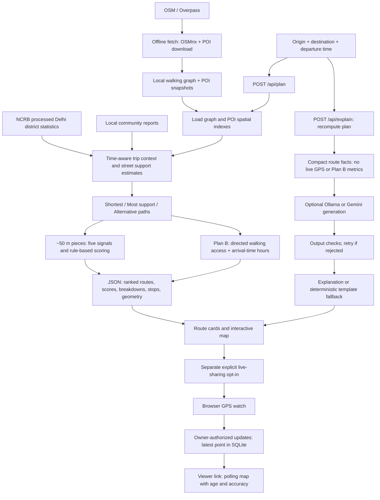

# SafeHer — current end-to-end implementation

**Last reviewed: October 13, 2026.** This document describes executable code and data in this checkout, not the full product roadmap.

**October 16 update:** an initial backend-only Google ADK Companion now adds intent routing and tool orchestration via `POST /api/chat`. See [chatbot implementation, setup and validation limits](../backend/CHATBOT_README.md). Live Ollama/ADK/Places smoke checks have passed, while model reliability and Geocoding billing/configuration remain open; this guide's original AI-boundary discussion below describes the route-comparison UI, not the new backend agent endpoint.

Start here for how the app works today. [DESIGN_SPEC.md](DESIGN_SPEC.md) describes the broader intended product and includes features that do not exist yet. Update this guide when implementation changes.

## 1. At a glance

SafeHer is a **walking-route comparison prototype** for two bounded pilot areas:

- Bengaluru: Indiranagar–MG Road (`blr-indiranagar-mg-road`).
- Delhi: Hauz Khas–Saket (`del-hauz-khas-saket`).

The backend is Python/FastAPI. The frontend is HTML/CSS/JavaScript with MapLibre. Route generation, support scoring, nearby lookup, reports, Plan B Coverage and live sharing are **not AI**. An optional LLM writes the route-comparison explanation after the calculations.

There is no trained SafeHer crime-prediction model. Scores indicate available supporting evidence, **not a probability of safety**. In an emergency, call 112.

## 2. End-to-end flow



VIIRS is an optional lighting input if a local grid is loaded; no grids are currently present. Neither the regular planning request nor its score calculation requires an LLM or live GPS.

### Route-planning steps

1. **Choose input:** a landmark, local POI search result, map location, or browser location. Set departure time or use now.
2. **Validate:** origin and destination must lie in the same pilot area. Omitted departure means now; a timestamp without timezone is interpreted in the area's timezone.
3. **Load cached data:** `routing.load_area()` reads `walk.graphml` and `pois.json`, classifies POIs, and builds spatial indexes. It does not fetch OSM per request.
4. **Snap endpoints:** find nearest walking graph nodes within 300 m. Reject no nearby street, identical snapped endpoints, or no connection. Snap connectors are not included as navigable first/last route segments.
5. **Build time context:** calculate sunrise/sunset, blend day/night weights, load the area's incident reading, and index community reports.
6. **Estimate street support:** midpoint signal scores steer the support-aware graph search. This cache uses an hourly time bucket and the report set; final route scoring uses requested departure time.
7. **Find candidates:** shortest distance first; support-weighted shortest paths and penalized-used-edge search produce distinct alternatives when possible. Alternatives must be at most 1.5× shortest length; paths with more than 80% overlap are rejected. The app returns up to three routes, not necessarily three.
8. **Score pieces:** split route geometry into roughly 50 m pieces, evaluate signals near each midpoint, then aggregate with length weighting.
9. **Describe:** identify weak stretches, nearby stops, highlights and reasons. Estimate duration at 80 m/min (4.8 km/h), not a live ETA.
10. **Compute Plan B independently:** estimate walking access to potentially available help points along the route.
11. **Return and render:** sort routes by rounded score, with missing scores last. Frontend draws geometry, scores, cards, details and clickable map highlights.
12. **Request explanation separately:** `/api/explain` recomputes the plan from origin/destination/time and supplies compact facts to the explanation pipeline; it does not accept the displayed plan as input.

## 3. Inputs and datasets

| Input | Source / local location | Current use and limits |
|---|---|---|
| Walking streets | OpenStreetMap via Overpass/OSMnx; `data/areas/<id>/walk.graphml` | Directed walking graph, geometry, length and tags; incomplete maps and boundaries limit routes. |
| Places, transit and lamps | OSM; `data/areas/<id>/pois.json` | Names, coordinates, kinds, hours/access tags; not verified support providers. Banks/ATMs are fetched but currently unclassified. |
| Snapshot metadata | `data/areas/<id>/meta.json` | Source attribution, fetch timestamp and raw record counts. |
| Historical incidents | NCRB Crime in India via India Data Portal; `data/incidents/ncrb_delhi_police_districts.json` | Delhi district-level registered counts; not street-level incident locations. |
| Community reports | App submissions; `backend/var/reports.jsonl` | Snapped location, category, timestamp, pending verification and optional note. Notes do not enter scoring or LLM facts. |
| Trip request | User input | Origin, destination and departure time; optional explanation language. |
| Live GPS | Browser geolocation after opt-in | Coordinates and accuracy for sharing only; not an input to the score or LLM. |
| Typical hours | `pois.py:TYPICAL_HOURS` | Manually coded assumptions when mapped hours are absent or invalid; flagged as assumed. |
| Weights, severities, landmarks, helplines | Python constants | Product assumptions/configuration, not learned datasets. |
| Satellite night lights | NASA Black Marble VNP46A4; optional `data/areas/<id>/viirs.npz` | Fetch/load support exists, but **not currently loaded**. Annual ~500 m upward-light estimates, not individual street lamps. |

### Checked-in OSM snapshots

Both were fetched October 7, 2026. Counts are raw snapshot totals, not counts of verified or currently open places.

| Pilot | Nodes | Directed edges | Raw POIs |
|---|---:|---:|---:|
| Bengaluru | 5,206 | 14,044 | 2,120 |
| Delhi | 2,913 | 7,908 | 667 |

NCRB processing averages selected public-space-related categories across **2019, 2021 and 2022** (2020 excluded). It assigns city-relative percentiles to Delhi territorial police districts at confidence **0.15**. Counts are not population-adjusted and reflect reporting as well as incidence. Delhi pilot routes share one district reading, so it does not differentiate them. Bengaluru has no usable sub-city incident reading.

The processed NCRB JSON is checked in; the source CSV expected by the rebuild script at `data/raw/ncrb/districtwise-caw-2017-onwards.csv` is not present in the checked-in data listing. See `ncrb.py` for the source resource URL.

CARTO basemap tiles are **visual context**, not scoring input. Google Maps is an external navigation handoff, not the route engine. Google Places, live transit feeds and Google route scoring are not implemented inputs.

## 4. How the support score works — no AI

Source: `signals.py`, `scoring.py`, `plan.py`.

Each reading has a value from 0–100 and confidence from 0–1.

| Signal | Current calculation |
|---|---|
| Lighting | Prefer `lit` tag, then mapped lamps within 25 m, then optional VIIRS, then low-confidence road-type prior. |
| Transit | Nearest expected-open stop: 100 within 150 m, falling linearly to 0 at 800 m. |
| Open places nearby | Expected-open support POIs within 150 m; police/hospitals count 1.5×; saturates at weighted count 3. |
| Historical incidents | Inverse of Delhi district's city-relative count percentile; missing in Bengaluru. |
| Community reports | Reports within 50 m apply category severity × verification factor × age decay; seven-day half-life, maximum age 30 days. Future-dated reports are ignored. |

Standard scoring checks opening hours at **departure time**, not estimated arrival at each piece. Plan B uses arrival-time checks separately. Nearby/score proximity uses haversine distance, not a walking detour. The score's open-place calculation does not apply Plan B's restricted-access filter.

| Signal | Day base weight | Night base weight |
|---|---:|---:|
| Lighting | 5% | 30% |
| Transit | 20% | 15% |
| Open places | 30% | 25% |
| Incidents | 20% | 15% |
| Reports | 25% | 15% |

Weights blend over 30-minute windows around sunrise/sunset. Missing confidence-zero signals contribute no weight; remaining weights are renormalized:

```text
effective_weight_i = (base_weight_i × confidence_i) / sum(base_weight × confidence)
segment_score = sum(effective_weight_i × signal_value_i)
route_score = 0.8 × length-weighted mean + 0.2 × length-weighted 10th-percentile score
```

The second term is a **percentile score**, not the mean of the weakest 10%. Segments below confidence mass 0.15 are unscored; routes with less than 50% scored length get no score. Bands: **More support ≥75**, **Mixed ≥50**, otherwise **Less support**. A weak stretch is a contiguous run below 50 lasting at least 100 m.

No reports produces a high report-signal value with low confidence (0.4); absence of reports must not be interpreted as absence of hazards. Verification states exist in calculations, but no verification/moderation workflow is implemented.

## 5. Plan B Coverage — no AI

Source: `backup.py`, `app/web/backup.js`.

- Reuses the walking graph and support POIs; excludes explicit `access=no/private/customers/permit/members`.
- Connects each eligible POI to a graph node within 100 m using an approximate straight-line connector.
- Samples route pieces roughly every 50 m; estimates arrival using network distance at 80 m/min.
- For each arrival-minute bucket, requires hours to indicate open across the following 16-minute window. Missing/invalid hours use typical assumptions. This conservative rule can exclude a nearby place that closes soon.
- Reversed multi-source Dijkstra computes directed walking distance **to** destinations. Interior samples use remaining edge offsets, allowing backward travel when a reverse edge exists.
- Searches up to 15 minutes; groups contiguous samples beyond five minutes or with no mapped option into gaps.
- Reports within-five-minute share, unavailable length, maximum known walk, least-covered known point, and the nearest option at that point.
- `max_walk_min` is **null if any sampled coverage is unavailable**, not zero. `max_known_walk_min` may still exist.
- Eligible/assumed-hour place counts are **area-wide sampled-time counts**, not places passed by a route.

Plan B does not change the score, candidate search, ranking or LLM facts. It does not verify entrances, crossings, actual accessibility, opening or willingness to assist.

## 6. The exact AI boundary

**Only the short route-comparison explanation currently uses generative AI.**

Source: `explain.py`; endpoint: `/api/explain`; frontend: explanation card in `app.js`.

```text
recomputed plan → compact facts → prompt → optional model → output checks
                                                    ↘ retry / template fallback
```

Facts contain city, local departure time, night flag, route labels, durations/distances, scores/bands, signal readings/confidence, reasons, weak stretches, stop names/types/open assumptions, and data notes. They exclude raw route coordinates, live GPS, report notes and Plan B metrics. Planned-trip context can still be sensitive.

Providers:

- `SAFEHER_LLM=ollama`: local Ollama `/api/generate`; `OLLAMA_MODEL` selects the model (local setup uses `llama3:latest`).
- `SAFEHER_LLM=gemini`: Gemini API; requires a configured key.
- Default `auto`: tries Gemini, then template when unavailable. **It does not auto-select Ollama.**
- `SAFEHER_LLM=template`: no model request.

Supports English (`en`) and Hindi (`hi`). Checks constrain wording, length, numbers, known forbidden place names, required score mentions and scripts. Rejected output gets one rewrite attempt per provider; unavailable/rejected output falls back to a deterministic template. Explanations are cached in process.

The API returns `text`, `provider`, `model`, `lang`, `checked`. Inspect `provider` to distinguish **actual AI text** from `template`. The `checked` flag is not proof of semantic truth: checks are limited, and the fallback is returned even if its own check reports problems internally. There is no trained prediction model, interactive Q&A, AI report moderation or AI hotspot narrative in the current app.

## 7. Other user-facing workflows

### Nearby places and navigation

`/api/nearby` searches within 2.5 km by haversine distance and category, supplies hours assumptions, phone when mapped, and nearby lamp counts. Only the `open_places` category filters out expected-closed results. It is not a network travel-time ranking. Route details choose the nearest police/washroom/hospital/pharmacy of each kind within 300 m of sampled route locations. Google Maps links hand off walking navigation; results there may differ from SafeHer's graph.

### Community reports

```text
Choose category + map point → POST /api/reports → snap to street node
→ append pending report to JSONL → public category/location marker → future route scoring
```

API accepts an optional note (max 280 characters); current UI submits location/category only. Public report responses omit notes but expose individual snapped coordinates, category, time and verification. There is **no H3 aggregation or k-anonymity protection** here. Snapping is not full anonymization. No rate-limiting, moderation or verification endpoint is implemented.

### Live location sharing

```text
Explicit permission → create selected-route session → browser watchPosition
→ owner-authorized PUT latest location → viewer polls → stop/delete or two-hour expiry
```

Source: `sharing.js`, `live.js`, `trips.py`.

- Creates independent random owner/viewer capability tokens; SQLite stores hashes, selected route and only the latest point/accuracy/server receipt time.
- Viewer link is `/live#<viewer-token>`; the viewer makes token-bearing API calls and polls every five seconds.
- Owner token authorizes updates and deletion. Anyone with the viewer link can view the trip.
- Sender tab stores credentials in session storage. Reload recovery requires explicit GPS resume.
- Viewer shows age, accuracy, expiry and a stale warning after 30 seconds.
- Stop deletes the session; expiry is purged on database access and periodically (about every minute while running). Closing a tab is not immediate revocation. Offline stop can fail and needs retry.
- Sender page must remain open; locked/background devices may pause updates. No WebSockets, SMS/contact delivery, arrival detection or native background tracking.
- Localhost or HTTPS is required for browser GPS. Localhost links work only on the same machine.
- Sensitive routes/GPS stay out of LLM processing. External tile services can infer the viewed map area. Public deployment needs HTTPS, abuse controls and security review; redact token-bearing paths and bodies from logs.

### SOS and map controls

SOS provides helpline call links, not automatic dispatch or alerts. App also offers local landmark/POI search, departure-time adjustment, lighting/POI layers, report markers, map selection, and light/dark presentation.

## 8. API inputs and outputs

Interactive schemas: FastAPI `/docs` or `/openapi.json` when the server is running.

| Method / endpoint | Input | Output |
|---|---|---|
| GET `/api/areas` | None | Pilot boundaries, centers and predefined landmarks. |
| GET `/api/meta` | None | Weights, bands, report categories, helplines, disclaimer. |
| GET `/api/search` | Query text, optional area and limit | Local landmark/POI matches; not general geocoding. |
| POST `/api/plan` | Origin, destination, optional departure | Ranked route JSON, described below. |
| POST `/api/explain` | Same trip fields + `lang` | Explanation text, provider/model, language and check flag. |
| GET `/api/nearby` | Lat/lon, category, optional time/limit | Places, distance, hours assumptions, optional phone. |
| GET `/api/layers/{area_id}` | Pilot ID | GeoJSON lamps, police stations and washrooms. |
| GET `/api/reports` | Optional area | Individual report metadata, excluding notes. |
| POST `/api/reports` | Lat/lon, category, optional note | Created pending report metadata. |
| POST `/api/trips` | Optional selected-route coordinate list | Owner/viewer tokens and expiry. |
| GET `/api/trips/{token}` | Viewer token | Route, expiry and latest location or null. |
| PUT `/api/trips/{token}/location` | Lat/lon/accuracy + owner bearer token | 204 on update. |
| DELETE `/api/trips/{token}` | Owner bearer token | 204 on revocation. |

Typical planning input:

```json
{
  "origin": {"lat": 28.5433, "lon": 77.2067},
  "destination": {"lat": 28.5286, "lon": 77.2195},
  "depart_at": "2026-10-13T23:45:00+05:30"
}
```

`/api/plan` output contains:

- Top level: `area`, `departure_local`, `night_fraction`, `weights_version`, `routes`, `data_notes`, `disclaimer`, `attribution`.
- Each route: `label`, `distance_m`, `duration_min`, nullable `score`, `band`, scored `coverage`, signal `breakdown`, `highlights`, `reasons`, `weak_stretches`, `stops`, `geometry`, `pieces`, `plan_b`.
- `coverage` is scoreable-length coverage; `plan_b.within_threshold_share` is help-access coverage. They are different metrics.

**Coordinate convention:** planning geometry/piece coordinates are `[latitude, longitude]`. GeoJSON and trip-session route input use `[longitude, latitude]`. Frontend converts between them; do not copy arrays across APIs without checking order.

## 9. Implemented vs planned

| Capability | Current status |
|---|---|
| Walking candidates and transparent score | Implemented, bounded pilot areas. |
| English/Hindi route explanation | Implemented; optional AI with template fallback. |
| Nearby places, stops, SOS call links | Implemented; availability not verified. |
| Reports and score impact | Implemented; pending reports, no moderation workflow. |
| Foreground live sharing | Implemented; expiring/revocable viewer link. |
| Plan B Coverage | Implemented; estimates independent of score. |
| VIIRS | Fetch/load code implemented; no current local grids. |
| H3 spatial cells, hotspot dashboard, five-report privacy threshold | **Planned, not implemented.** Current index is a rectangular lat/lon grid (`PointIndex`, 0.002-degree cells); route sampling is ~50 m, not H3. |
| General multilingual Q&A and AI moderation | Planned, not implemented. |
| Recommendation stability / Privacy Zones | Proposed, not implemented. |
| Native background GPS, off-route/arrival alerts, automatic contact delivery | Not implemented. |
| Production authentication/abuse controls and nationwide data coverage | Not implemented. |

## 10. Code navigation and storage

| File | Responsibility |
|---|---|
| `backend/safeher/api.py` | App setup, HTTP contracts, search, nearby/layers, reports, explanation orchestration. |
| `backend/safeher/areas.py` | Pilot geography and timezone configuration. |
| `backend/safeher/osm.py`, `fetch.py` | Rebuild OSM snapshots outside request handling. |
| `backend/safeher/routing.py` | Load/cache graph, indexes, snapping and candidate paths. |
| `backend/safeher/pois.py`, `geo.py` | POI classification/hours, spatial index, distance/geometry helpers. |
| `backend/safeher/plan.py` | Trip orchestration, sampling, highlights, stops, output construction. |
| `backend/safeher/signals.py`, `scoring.py` | Five signal formulas and aggregate score. |
| `backend/safeher/ncrb.py`, `viirs.py` | Historical incident transformation and optional satellite adapter. |
| `backend/safeher/backup.py` | Independent walking-network help-access metric. |
| `backend/safeher/explain.py` | Facts, prompts, model adapters, checks and fallback. |
| `backend/safeher/trips.py` | Latest-location session persistence and capabilities. |
| `app/web/app.js`, `backup.js` | Main UI, API requests and Plan B interactions. |
| `app/web/sharing.js`, `live.html`, `live.js` | Sender and recipient sharing experiences. |
| `backend/tests/test_*.py` | API, routing, scoring, real-data, explanation, sharing, Plan B and adapter regressions. |
| `demo/README.md` | Demo recorders, simulated-GPS and cached-map disclosure. |

Checked-in source datasets are under `data/`; runtime reports/trips are under `backend/var/`. Provider settings/secrets are in ignored `backend/.env`, not documentation or source control. Graphs, edge-support and explanation caches are in-process; refreshing datasets generally requires a server restart to avoid old cached data.

## 11. Run and inspect

From `backend/`, with the existing project environment installed:

```bash
../.venv/bin/uvicorn safeher.api:app --port 8765 --no-access-log
```

- App: http://localhost:8765
- API schemas: http://localhost:8765/docs
- Latest video: [HerSide Q&A + Plan B + live sharing demo](media/safeher-demo-herside.mp4)
- Regression suite: `cd backend && ../.venv/bin/python -m pytest -q`

Last recorded feature-validation result: **168 passed, 1 skipped**, plus browser interaction checks for sharing and Plan B. This is historical verification, not a guarantee that every future checkout has been tested. See [README.md](../README.md) for installation and provider configuration.
