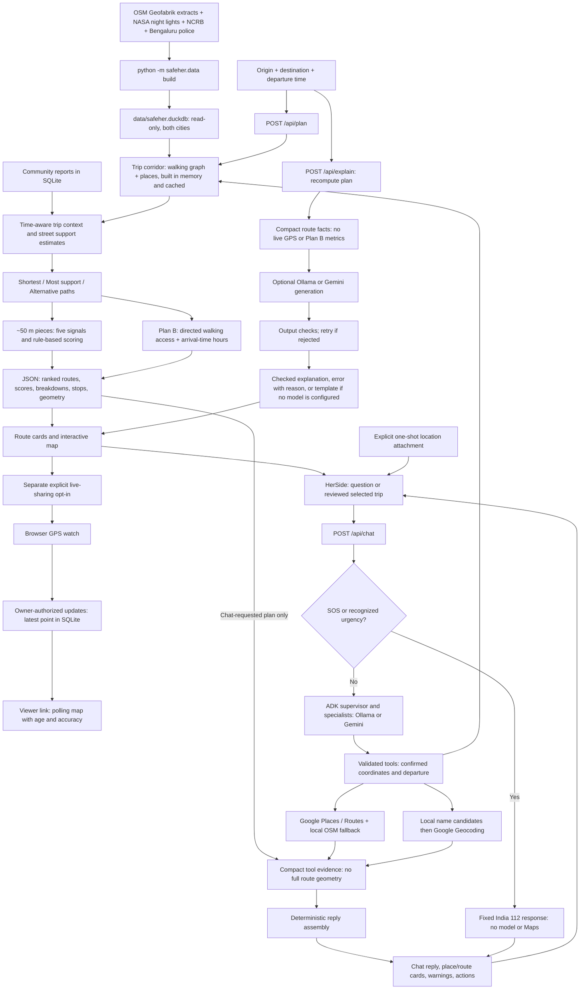
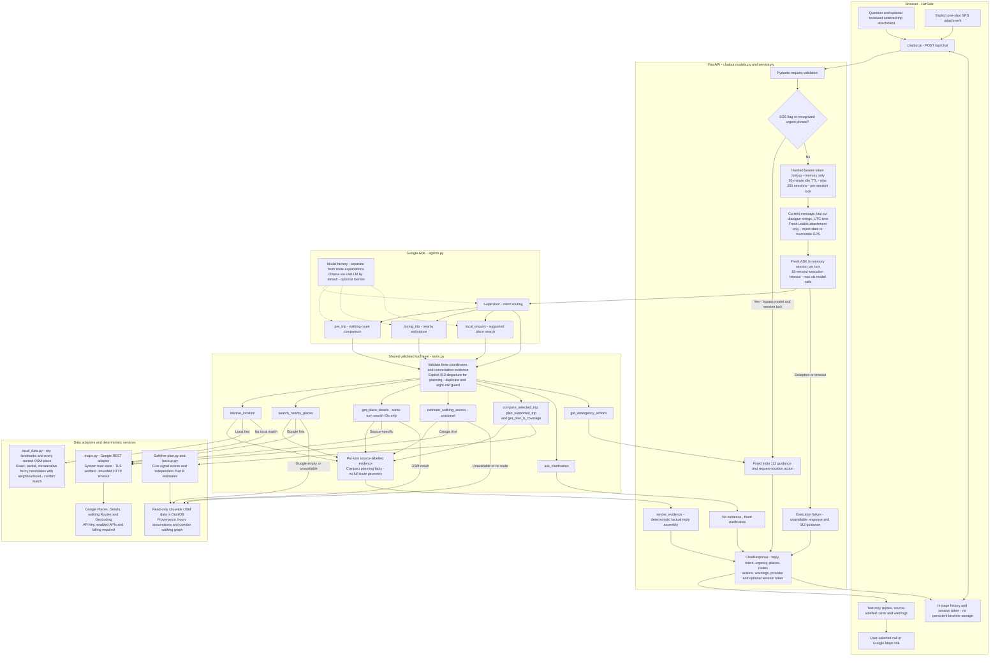

# SafeHer — current end-to-end implementation

**Last reviewed: October 16, 2026** (updated for the city-wide data when HerSide was merged). This document describes executable code and data in this checkout, not the full product roadmap.

**Current scope:** route comparison, Plan B Coverage, opt-in live sharing, and the initial **HerSide** chat UI are integrated. HerSide uses Google ADK with Ollama-driven tool selection and evidence-rendered replies through `POST /api/chat`. This is ready for initial integration/demo use, not production-complete. Model reliability, natural-language time handling and Google Geocoding configuration remain open. See [chatbot setup and validation details](../backend/CHATBOT_README.md).

Start here for how the app works today. [DESIGN_SPEC.md](DESIGN_SPEC.md) describes the broader intended product and includes features that do not exist yet. Update this guide when implementation changes.

## 1. At a glance

SafeHer is a **walking-route comparison prototype** for two whole cities, Delhi and Bengaluru (any walk inside one city, up to 8 km straight-line). Trips elsewhere, or across the two cities, get a clear 422 message. All reference data is built once into `data/safeher.duckdb` by `python -m safeher.data build`; see [ARCHITECTURE.md](ARCHITECTURE.md) for the data sources and the full request flow.

The backend is Python/FastAPI. The frontend is HTML/CSS/JavaScript with MapLibre. Route generation, support scoring, nearby lookup, reports, Plan B Coverage and live sharing are **not AI**. AI has two separate roles: an optional LLM writes route-comparison explanations after calculation; HerSide uses an LLM to route requests and select tools. Neither role computes or changes support scores.

There is no trained SafeHer crime-prediction model. Scores indicate available supporting evidence, **not a probability of safety**. In an emergency, call 112.

## 2. End-to-end flow



NASA VIIRS night lights are loaded for both cities and used where OSM has no `lit` tag or mapped lamp. Neither the regular planning request nor its score calculation requires an LLM or live GPS. HerSide is an additional entry point to validated tools; it does not replace the route engine or share live-trip credentials with agents. See section 6 for its full turn-by-turn flow.

### Route-planning steps

1. **Choose input:** a landmark, local POI search result, map location, or browser location. Set departure time or use now.
2. **Validate:** origin and destination must lie in the same supported city, at most 8 km apart. Omitted departure means now; a timestamp without timezone is interpreted in the city's timezone.
3. **Load the corridor:** `store.corridor_data()` cuts the trip's corridor (both points + 1.2 km) from DuckDB, builds the walking graph and spatial indexes in memory (0.2–3 s) and caches it (LRU of 24). Nothing is fetched per request.
4. **Snap endpoints:** find nearest walking graph nodes within 300 m. Reject no nearby street, identical snapped endpoints, or no connection. Snap connectors are not included as navigable first/last route segments.
5. **Build time context:** calculate sunrise/sunset, blend day/night weights, look up the NCRB police district at each sampled point (Delhi), and index community reports.
6. **Estimate street support:** midpoint signal scores steer the support-aware graph search. This cache uses an hourly time bucket and the report set; final route scoring uses requested departure time.
7. **Find candidates:** shortest distance first; support-weighted shortest paths and penalized-used-edge search produce distinct alternatives when possible. Alternatives must be at most 1.5× shortest length; paths with more than 80% overlap are rejected. The app returns up to three routes, not necessarily three.
8. **Score pieces:** split route geometry into roughly 50 m pieces, evaluate signals near each midpoint, then aggregate with length weighting.
9. **Describe:** identify weak stretches, nearby stops, highlights and reasons. Estimate duration at 80 m/min (4.8 km/h), not a live ETA.
10. **Compute Plan B independently:** estimate walking access to potentially available help points along the route.
11. **Return and render:** sort routes by rounded score, with missing scores last. Frontend draws geometry, scores, cards, details and clickable map highlights.
12. **Request explanation separately:** `/api/explain` recomputes the plan from origin/destination/time and supplies compact facts to the explanation pipeline; it does not accept the displayed plan as input.

## 3. Inputs and datasets

| Input | Source / local location | Current use and limits |
|---|---|---|
| Walking streets | OpenStreetMap Geofabrik extracts (OSMnx walk rules); `segments` in `data/safeher.duckdb` | Walking graph, length and tags for both whole cities; incomplete maps limit routes. |
| Places, transit and lamps | OSM; `places` in DuckDB | Names, coordinates, kinds, hours/access tags; not verified support providers. Search uses every named place. |
| Build metadata | `sources` in DuckDB | What each city was built from, and when (`python -m safeher.data info`). |
| Historical incidents | NCRB Crime in India via India Data Portal; `districts` + `incidents` in DuckDB | Delhi police-district registered counts, looked up per point via OSM district polygons; not street-level incident locations. |
| City-wide police figures | Bengaluru City Police via OpenCity; `city_stats` in DuckDB | Bengaluru molestation and insulting-modesty cases 2021–23, shown as context only (no district split, so never scored). |
| Community reports | App submissions; `backend/var/safeher.sqlite3` | Snapped location, category, timestamp, pending verification and optional note. Notes do not enter scoring or LLM facts. |
| Trip request | User input | Origin, destination and departure time; optional explanation language. |
| Live-sharing GPS | Browser `watchPosition` after separate sharing opt-in | Latest point/accuracy for a capability-protected trip session; not automatically supplied to chat or scoring. |
| Chat question/context | User-entered text, last six stored user/reply strings | Supplied to the configured chat model; can include sensitive trip details. |
| Chat location | Explicit one-shot `getCurrentPosition` attachment | Fresh, sufficiently accurate location is supplied to the chat model and relevant tools; never starts live sharing. |
| Google place/address/walking data | Places, Geocoding and Routes APIs, used by chat tools | Live external lookup, source-labelled; not persisted into OSM snapshots or used as support-score inputs. |
| Typical hours | `pois.py:TYPICAL_HOURS` | Manually coded assumptions when mapped hours are absent or invalid; flagged as assumed. |
| Weights, severities, landmarks, helplines | `config/scoring.json`, `config/cities.json`, `config/app.json` | Product assumptions/configuration, not learned datasets. |
| Satellite night lights | NASA Black Marble VNP46A4 2025; `night_lights` in DuckDB | Loaded for both cities (Delhi 14,750 px, Bengaluru 6,083 px). Annual ~460 m upward-light estimates, not individual street lamps; also drawn as the night-glow map layer. |

### Built data (October 16, 2026)

| City | Street segments | Places | NASA pixels | NCRB districts |
|---|---:|---:|---:|---:|
| Delhi | 997,981 | 33,367 | 14,750 | 15 |
| Bengaluru | 612,470 | 50,522 | 6,083 | none (city-wide police figures only) |

NCRB processing averages selected public-space-related categories across **2019, 2021 and 2022** (2020 excluded). It assigns city-relative percentiles to Delhi territorial police districts at confidence **0.15**. Counts are not population-adjusted and reflect reporting as well as incidence. A route crossing districts uses each one's figure. Old Delhi, Central North Delhi and the Gurugram/Faridabad parts of the Delhi box have no mapping (no data). Bengaluru has no sub-city incident reading.

CARTO basemap tiles are **visual context**, not scoring input. Google Maps is an external navigation handoff. When a Google key is set, the app also scores Google's walking route with SafeHer's engine. HerSide additionally uses Google Places/Details and Google walking Routes; local name search precedes Google Geocoding. These do not feed the five-signal score. Live transit feeds are not implemented.

## 4. How the support score works — no AI

Source: `signals.py`, `scoring.py`, `plan.py`.

Each reading has a value from 0–100 and confidence from 0–1.

| Signal | Current calculation |
|---|---|
| Lighting | Prefer `lit` tag, then mapped lamps within 25 m, then optional VIIRS, then low-confidence road-type prior. |
| Transit | Nearest expected-open stop: 100 within 150 m, falling linearly to 0 at 800 m. |
| Open places nearby | Expected-open support POIs within 150 m; police/hospitals count 1.5×; saturates at weighted count 3. |
| Historical incidents | Inverse of Delhi district's city-relative count percentile; missing in Bengaluru. |
| Community reports | Reports within 50 m apply category severity × verification factor × age decay; seven-day half-life, maximum age 30 days. Future-dated reports are ignored. |

Standard scoring checks opening hours at **departure time**, not estimated arrival at each piece. Plan B uses arrival-time checks separately. Nearby/score proximity uses haversine distance, not a walking detour. The score's open-place calculation does not apply Plan B's restricted-access filter.

| Signal | Day base weight | Night base weight |
|---|---:|---:|
| Lighting | 5% | 30% |
| Transit | 20% | 15% |
| Open places | 30% | 25% |
| Incidents | 20% | 15% |
| Reports | 25% | 15% |

Weights blend over 30-minute windows around sunrise/sunset. Missing confidence-zero signals contribute no weight; remaining weights are renormalized:

```text
effective_weight_i = (base_weight_i × confidence_i) / sum(base_weight × confidence)
segment_score = sum(effective_weight_i × signal_value_i)
route_score = 0.8 × length-weighted mean + 0.2 × length-weighted 10th-percentile score
```

The second term is a **percentile score**, not the mean of the weakest 10%. Segments below confidence mass 0.15 are unscored; routes with less than 50% scored length get no score. Bands: **More support ≥75**, **Mixed ≥50**, otherwise **Less support**. A weak stretch is a contiguous run below 50 lasting at least 100 m.

No reports produces a high report-signal value with low confidence (0.4); absence of reports must not be interpreted as absence of hazards. Verification states exist in calculations, but no verification/moderation workflow is implemented.

## 5. Plan B Coverage — no AI

Source: `backup.py`, `app/web/backup.js`.

- Reuses the walking graph and support POIs; excludes explicit `access=no/private/customers/permit/members`.
- Connects each eligible POI to a graph node within 100 m using an approximate straight-line connector.
- Samples route pieces roughly every 50 m; estimates arrival using network distance at 80 m/min.
- For each arrival-minute bucket, requires hours to indicate open across the following 16-minute window. Missing/invalid hours use typical assumptions. This conservative rule can exclude a nearby place that closes soon.
- Reversed multi-source Dijkstra computes directed walking distance **to** destinations. Interior samples use remaining edge offsets, allowing backward travel when a reverse edge exists.
- Searches up to 15 minutes; groups contiguous samples beyond five minutes or with no mapped option into gaps.
- Reports within-five-minute share, unavailable length, maximum known walk, least-covered known point, and the nearest option at that point.
- `max_walk_min` is **null if any sampled coverage is unavailable**, not zero. `max_known_walk_min` may still exist.
- Eligible/assumed-hour place counts are **area-wide sampled-time counts**, not places passed by a route.

Plan B does not change the score, candidate search, ranking or LLM facts. It does not verify entrances, crossings, actual accessibility, opening or willingness to assist.

## 6. The exact AI boundary

There are **two independent AI pipelines**, with separate provider settings. Model output never replaces deterministic routing/scoring. The urgent chat fast path does not use AI.

### 6.1 Route-comparison explanation

Source: `explain.py`; endpoint: `/api/explain`; frontend: explanation card in `app.js`.

```text
recomputed plan → compact facts → prompt → optional model → output checks
                                                    ↘ one retry, then an error (template only if no model is configured)
```

Facts contain city, local departure time, night flag, route labels, durations/distances, scores/bands, signal readings/confidence, reasons, weak stretches, stop names/types/open assumptions, and data notes. They exclude raw route coordinates, live GPS, report notes and Plan B metrics. Planned-trip context can still be sensitive.

Providers:

- `SAFEHER_LLM=ollama`: local Ollama `/api/generate`; `OLLAMA_MODEL` selects the model (local setup uses `llama3:latest`).
- `SAFEHER_LLM=gemini`: Gemini API; requires a configured key.
- Default `auto`: tries Gemini, then template when unavailable. **It does not auto-select Ollama.**
- `SAFEHER_LLM=template`: no model request.

Supports English (`en`) and Hindi (`hi`). Checks constrain wording, length, numbers, known forbidden place names, required score mentions and scripts. Rejected output gets one rewrite attempt per provider; unavailable/rejected output falls back to a deterministic template. Explanations are cached in process.

The API returns `text`, `provider`, `model`, `lang`, `checked`. Inspect `provider` to distinguish **actual AI text** from `template`. The `checked` flag is not proof of semantic truth: checks are limited, and the fallback is returned even if its own check reports problems internally. There is no trained prediction model, AI report moderation or AI hotspot narrative. Interactive local-place/trip Q&A is implemented separately as HerSide below.

### 6.2 HerSide: end-to-end conversational flow

Sources: `app/web/chatbot.js`, `chatbot.css`, dialog markup in `index.html`; `backend/safeher/chatbot/{models,service,agents,tools,maps,local_data}.py`.

#### Detailed chatbot architecture

Solid arrows show request/data flow; dotted arrows show model configuration. The emergency preflight returns directly without initializing ADK or calling Google. Tools execute inside the same backend, not separate microservices.



**Reading the boundaries:** chat context and tool results can reach the configured model; relevant lookup coordinates/address queries reach Google. Continuous live-sharing GPS/tokens are not automatically available to agents. Google walking estimates are not SafeHer-scored routes, and Google results are not merged into OSM snapshots. Session lookup/validation errors return HTTP errors, while model/tool execution failures use a structured unavailable reply. The next sequence diagram shows one request through these components.


```mermaid
sequenceDiagram
    participant U as User
    participant H as HerSide UI
    participant API as Chat service
    participant A as ADK supervisor / specialist
    participant T as Validated tools
    participant D as SafeHer / local OSM / Google
    U->>H: Question, structured selected trip, optional location attachment
    H->>API: POST /api/chat: message, session_id, sos, location, trip, lang
    alt Explicit SOS or recognized urgent phrase
        API-->>H: Fixed India 112 response and request-location action
    else Ordinary turn
        API->>API: Validate session; acquire lock; build bounded context
        API->>A: Current message + recent dialogue + usable location
        A->>T: Structured tool call after specialist delegation
        T->>T: Check arguments, coordinate evidence, time and tool budget
        T->>D: Search, walking estimate or SafeHer plan
        D-->>T: Source-labelled facts or unavailable result
        T-->>API: Retained per-turn evidence
        API->>API: Assemble reply/cards from evidence, not model prose
        API-->>H: Reply, places/routes, warnings, actions, session token
    end
    H-->>U: Text-only rendered results; explicit call/navigation choices
```

1. **Open and compose:** launch **HerSide · Ask for help**. Native modal, keyboard focus handling, suggested pharmacy question, selected-trip shortcut, separate SOS button and persistent India 112 link are available. UI currently submits English (`lang: "en"`); API accepts `en`/`hi`, but Hindi journey quality is not fully validated.
2. **Review trip context:** “Compare my selected trip” attaches selected origin/destination and timezone-aware departure as structured `trip` context and fills a natural trade-off question. It does not submit automatically; the attachment is sent only with the next message and cleared on send/close/reset. There is no automatic map/chat synchronization, private-trip lookup, persistent home address, or live-sharing access.
3. **Attach location only by choice:** attachment invokes `getCurrentPosition`, not `watchPosition`. Coordinates, accuracy and observation timestamp are sent only on the next submission. UI discards an attachment older than two minutes and clears it after sending, removing it or closing the dialog. Merely opening chat never requests GPS.
4. **Validate and check urgency first:** Pydantic validates request sizes, coordinates and language. Explicit `sos=true` or recognized urgent English/Hindi phrases return fixed India 112 guidance **before** session lookup, locking, ADK or external calls. This is phrase-based, not a reliable danger classifier. An agent can also escalate through `get_emergency_actions`. The fast response does not automatically start a nearby search; that needs a later turn.
5. **Recover bounded conversation:** an opaque bearer session token is sent in the JSON body, hashed for server lookup. Sessions are process-memory only, capped at 200, with a 30-minute idle TTL and pruning during session access. Each keeps the last six user/reply strings (roughly three turns), not a full persistent transcript. Concurrent ordinary turns for one session get HTTP 409; expired/missing sessions get 404; capacity exhaustion gets 503. UI resets its token on 404 and asks the user to resend.
6. **Build fresh ADK context:** each turn gets a temporary `InMemorySessionService` session, deleted after the turn. Context includes language, current UTC time, current message, recent dialogue and location warnings. Attachment timestamps must include timezone, be no more than 120 seconds old or 30 seconds in the future, and accuracy must be ≤100 m. Unusable attachments are not supplied as confirmed coordinates to the model/tools. This does not erase coordinates the user explicitly typed in messages/history.
7. **Delegate:** `supervisor` chooses `pre_trip`, `during_trip` or `local_enquiry` using structured ADK transfers. Specialists share validation/tools. Temperature is zero, but handoffs and argument extraction remain model-dependent. Malformed/null/nonfinite coordinate arguments trigger errors/clarification rather than being trusted. Duplicate identical calls and calls beyond eight callback-counted tool invocations are blocked; runner also limits execution to six model calls and 60 seconds per turn.
8. **Execute grounded tools:** coordinates must match an accepted attachment, per-turn place evidence, or numeric evidence in the conversation. This is an initial numeric-evidence guard, not semantic proof that a location is correct. Pilot planning additionally requires an explicitly confirmed ISO departure timestamp with timezone, from conversation evidence or the validated selected-trip attachment. Missing/ambiguous inputs should lead to fixed clarification questions, not guessed home locations, times or cities.
9. **Assemble evidence:** tools retain per-turn results; `render_evidence()` builds reply text, place/route records, warnings and action descriptors. Raw model prose is not used for factual answers. If no evidence exists, return a deterministic clarification. Execution failure/timeouts return an unavailable response with nearby-search and 112 guidance. `provider="adk"` describes orchestration, not independently verified prose; SOS uses `deterministic`.
10. **Render safely:** UI uses `textContent` for provider/model-derived text, not injected HTML. Cards label sources, distance/hour basis, snapshot metadata when present, and warnings. Google place results link to Google Maps rather than being plotted on the OSM map. Route cards summarize distance/time, support score where present and Plan B share; they do not automatically replace the selected map route. Supported call links are allowlisted; calls and external navigation still require user action.
11. **Keep emergency access independent:** SOS can interrupt the browser's pending fetch; its fixed server response does not wait for an ordinary turn's session lock. The UI has a 70-second request timeout and leaves the 112 link visible. Browser cancellation/closing is not a guarantee that server work stopped immediately.

### 6.3 Tool and provider decisions

| Need / tool | Actual source order and boundary |
|---|---|
| `resolve_location` | Curated landmarks and cached OSM names/aliases first: normalized case/punctuation, Bangalore/Bengaluru aliases, exact/partial/conservative fuzzy matching. Return up to three candidates requiring confirmation. Google Geocoding only when no local match; unavailable results request a more specific landmark/coordinates. Not a worldwide local address index. |
| `search_nearby_places` | Google Places first for pharmacy, police, hospital, toilets, cafe or supermarket; up to three within 2.5 km. If unavailable/empty, use city-wide OSM data with explicit fallback warning, build date/attribution, restricted-access exclusion and deduplication. Distances are straight-line, not walking times; places are not guaranteed open or able to assist. |
| `get_place_details` | Only IDs returned by a search in the same turn. Google Details for Google places; cached OSM records for OSM places. Details are not a verification of current availability. |
| `estimate_walking_access` | Google Routes in `WALK` mode first; directed local walking graph fallback when both points are within cached coverage. Local duration uses 80 m/min and approximate endpoint connectors, not verified entrances/crossings. Neither estimate has a SafeHer score or live ETA. |
| `compare_selected_trip` | Reads only the explicit structured trip attachment; reuses validated planning and renders extra minutes, support/lighting scores, confidence and weak-stretch counts. No user-entered coordinates required. |
| `plan_supported_trip` | Calls existing Python `plan()` with current report inputs, not an LLM route generator. Returns compact route labels, distance/time, scores/breakdown, reasons, weak stretches and Plan B. Full route geometry/pieces are omitted, but compact weak-stretch/Plan B records can still contain location data. Scored planning covers Delhi and Bengaluru only. |
| `ask_google_maps` | **Grounding with Google Maps** (Gemini on Vertex AI, `chatbot/grounding.py`): questions about places, such as opening hours, how busy, what reviews say, or kinds of place the nearby search doesn't cover. Centred on the attached location, else the trip destination, else a place found this turn. The answer is an AI summary shown with its Google Maps sources right after it, each attributed "Google Maps" with the returned title linked to its URI. Never a SafeHer score; needs `GOOGLE_CLOUD_PROJECT` + ADC; billed per Maps query. |
| `get_plan_b_coverage` | Reads a route computed in the same turn; cannot retrieve another user's private live trip. |
| `ask_clarification` / `get_emergency_actions` | Fixed prompts or India 112 escalation; no fabricated facts, dispatch, calls or automatic sharing. |

Chat uses `CHATBOT_PROVIDER=ollama` by default with `CHATBOT_MODEL=llama3.2:3b`, ADK `LiteLlm` identifier `ollama_chat/<model>` and `OLLAMA_API_BASE` (default localhost:11434). `CHATBOT_PROVIDER=gemini` selects native ADK Gemini (default `gemini-2.5-flash`); it requires credentials and fresh regression testing. These settings are **separate** from explanation settings `SAFEHER_LLM`/`OLLAMA_MODEL`. There is no automatic cross-provider chat failover or DuckDB/vector database dependency.

Google tools require `GOOGLE_MAPS_API_KEY`, enabled APIs and billing. HTTPS verification remains enabled using the system trust store (`truststore`). Places, Details and walking Routes passed live checks; Geocoding returned a billing/configuration denial in the tested setup. Local resolution and explicit coordinates avoid depending on that unresolved service.

### 6.4 Privacy, limitations and a verified example

- Chat message text, recent dialogue, usable attached coordinates and tool facts reach the configured chat model. Local Ollama avoids a remote model provider, **not** Google Maps calls. Gemini sends that context to its remote provider. Search anchors, addresses and walking endpoints go to relevant Google APIs. Do not tell users that all chat location data stays local.
- Sharing tokens/latest live GPS are not automatically supplied to chat. Chat's explicit one-shot attachment and continuous foreground sharing have separate consent/lifecycles. No calls, contact notifications or sharing start automatically.
- Browser chat history/token stay in JavaScript memory, not local/session storage. Closing clears the attachment and pending UI request but retains the in-page conversation. Reload loses local chat state. “Clear this chat” resets browser history/token, **not immediate server deletion**; server context expires independently. Avoid logging chat bodies, credentials, provider URLs/queries or tokens.
- Multi-turn context exists but is bounded; candidate confirmation, natural-language departure parsing, local-name tool selection and small-model reliability remain incomplete. Fuzzy search tools work independently of whether the model selects them correctly. No unrestricted web Q&A, verified refuge recommendations, nationwide scored routing, emergency dispatch or production authentication/abuse controls.
- Verified demo question: **“For this walk, is the extra walking time worth it for better lighting and fewer weak stretches?”** The user attaches the selected trip through the UI, not coordinate text. Three consecutive live Ollama checks returned computed route comparisons. The [latest video](media/safeher-demo-herside.mp4) demonstrates this pre-trip trade-off, SOS, Plan B and visibly simulated live-sharing GPS.

## 7. Other user-facing workflows

### Nearby places and navigation

`/api/nearby` searches within 2.5 km by haversine distance and category, supplies hours assumptions, phone when mapped, and nearby lamp counts. Only the `open_places` category filters out expected-closed results. It is not a network travel-time ranking. Route details choose the nearest police/washroom/hospital/pharmacy of each kind within 300 m of sampled route locations. Google Maps links hand off walking navigation; results there may differ from SafeHer's graph.

### Community reports

```text
Choose category + map point → POST /api/reports → snap to street node
→ append pending report to JSONL → public category/location marker → future route scoring
```

API accepts an optional note (max 280 characters); current UI submits location/category only. Public report responses omit notes but expose individual snapped coordinates, category, time and verification. There is **no H3 aggregation or k-anonymity protection** here. Snapping is not full anonymization. No rate-limiting, moderation or verification endpoint is implemented.

### Live location sharing

```text
Explicit permission → create selected-route session → browser watchPosition
→ owner-authorized PUT latest location → viewer polls → stop/delete or two-hour expiry
```

Source: `sharing.js`, `live.js`, `trips.py`.

- Creates independent random owner/viewer capability tokens; SQLite stores hashes, selected route and only the latest point/accuracy/server receipt time.
- Viewer link is `/live#<viewer-token>`; the viewer makes token-bearing API calls and polls every five seconds.
- Owner token authorizes updates and deletion. Anyone with the viewer link can view the trip.
- Sender tab stores credentials in session storage. Reload recovery requires explicit GPS resume.
- Viewer shows age, accuracy, expiry and a stale warning after 30 seconds.
- Stop deletes the session; expiry is purged on database access and periodically (about every minute while running). Closing a tab is not immediate revocation. Offline stop can fail and needs retry.
- Sender page must remain open; locked/background devices may pause updates. No WebSockets, SMS/contact delivery, arrival detection or native background tracking.
- Localhost or HTTPS is required for browser GPS. Localhost links work only on the same machine.
- This sharing workflow does not send its stored route, tokens or live GPS to an LLM. Separately, HerSide sends user-provided trip text/usable attached location to its configured model (section 6.4). External tile services can infer the viewed map area. Public deployment needs HTTPS, abuse controls and security review; redact token-bearing paths and bodies from logs.

### SOS and map controls

SOS provides helpline call links, not automatic dispatch or alerts. App also offers local landmark/POI search, departure-time adjustment, lighting/POI layers, report markers, map selection, and light/dark presentation.

## 8. API inputs and outputs

Interactive schemas: FastAPI `/docs` or `/openapi.json` when the server is running.

| Method / endpoint | Input | Output |
|---|---|---|
| GET `/api/cities` | None | Supported cities: bbox, centre, timezone, landmarks, default trip. |
| GET `/api/meta` | None | Weights, bands, report categories, helplines, disclaimer. |
| GET `/api/search` | Query text, optional city, map centre and limit | City-wide landmark, place, neighbourhood and street matches with neighbourhood; Google suggestions when enabled. |
| POST `/api/plan` | Origin, destination, optional departure | Ranked route JSON, described below. |
| POST `/api/explain` | Same trip fields + `lang` | Explanation text, provider/model, language and check flag. |
| POST `/api/chat` | Message, optional session token/location, SOS flag and language | Evidence-rendered reply, intent/urgency, clarification flag, places/routes, actions, warnings, provider and session token. |
| GET `/api/nearby` | Lat/lon, category, optional time/limit | Places, distance, hours assumptions, optional phone. |
| GET `/api/layers` | Visible box (south, west, north, east; ≤ 0.05° × 0.05°) | GeoJSON lamps, lit streets, NASA night-light pixels, police stations and washrooms. |
| GET `/api/reports` | Optional city | Individual report metadata, excluding notes. |
| POST `/api/reports` | Lat/lon, category, optional note | Created pending report metadata. |
| POST `/api/trips` | Optional selected-route coordinate list | Owner/viewer tokens and expiry. |
| GET `/api/trips/{token}` | Viewer token | Route, expiry and latest location or null. |
| PUT `/api/trips/{token}/location` | Lat/lon/accuracy + owner bearer token | 204 on update. |
| DELETE `/api/trips/{token}` | Owner bearer token | 204 on revocation. |

Typical planning input:

```json
{
  "origin": {"lat": 28.5433, "lon": 77.2067},
  "destination": {"lat": 28.5286, "lon": 77.2195},
  "depart_at": "2026-10-13T23:45:00+05:30"
}
```

`/api/plan` output contains:

- Top level: `area` (the trip corridor: `id`, `city`, `name`), `departure_local`, `night_fraction`, `weights_version`, `routes`, `data_notes`, `disclaimer`, `attribution`.
- Each route: `label`, `distance_m`, `duration_min`, nullable `score`, `band`, scored `coverage`, signal `breakdown`, `highlights`, `reasons`, `weak_stretches`, `stops`, `geometry`, `pieces`, `plan_b`.
- `coverage` is scoreable-length coverage; `plan_b.within_threshold_share` is help-access coverage. They are different metrics.

Typical initial chat input (no previous session; without a location this should ask for clarification):

```json
{
  "message": "Where is the nearest pharmacy?",
  "sos": false,
  "lang": "en"
}
```

For follow-ups pass the returned `session_id` as a secret bearer capability. Optional `trip` contains `origin`/`destination` objects (`lat`, `lon`) and timezone-aware `depart_at`. It is only included after explicit UI attachment and is available to the configured model; it does not read live-sharing sessions. Optional `location` contains `lat`, `lon`, `accuracy_m`, and timezone-aware `observed_at`; `message` must be 1–2000 characters. Chat output contains `session_id`, `reply`, `intent`, `urgency`, `needs_clarification`, `places`, `routes`, `actions`, `warnings`, `provider`. Action contracts include `call`, `request_location`, `show_place`, `open_directions`; the current UI renders allowed call/location actions and its own place/Google Maps controls, not a general arbitrary action executor. An urgent response does not create/refresh a chat session.

**Coordinate convention:** planning geometry/piece coordinates are `[latitude, longitude]`. GeoJSON and trip-session route input use `[longitude, latitude]`. Frontend converts between them; do not copy arrays across APIs without checking order.

## 9. Implemented vs planned

| Capability | Current status |
|---|---|
| Walking candidates and transparent score | Implemented, whole of Delhi and Bengaluru. |
| English/Hindi route explanation | Implemented; Gemini or Ollama when configured (errors shown, no silent fallback), template when no model is configured. |
| Nearby places, stops, SOS call links | Implemented; availability not verified. |
| Reports and score impact | Implemented; pending reports, no moderation workflow. |
| Foreground live sharing | Implemented; expiring/revocable viewer link. |
| Plan B Coverage | Implemented; estimates independent of score. |
| VIIRS night lights | Implemented for both cities; scoring fallback and night-glow map layer. |
| H3 spatial cells, hotspot dashboard, five-report privacy threshold | **Planned, not implemented.** Current index is a rectangular lat/lon grid (`PointIndex`, 0.002-degree cells); route sampling is ~50 m, not H3. |
| HerSide local-place/trip Q&A | Initial UI + ADK backend implemented; bounded context, validated tools and evidence rendering. |
| Hybrid Google/OSM chatbot tools | Implemented; live Places/Details/Routes passed, Geocoding configuration remains open. |
| General multilingual Q&A and AI moderation | Not implemented; chat API accepts Hindi but full Hindi journey quality is not validated. |
| Recommendation stability / Privacy Zones | Proposed, not implemented. |
| Native background GPS, off-route/arrival alerts, automatic contact delivery | Not implemented. |
| Production authentication/abuse controls and nationwide data coverage | Not implemented. |

## 10. Code navigation and storage

| File | Responsibility |
|---|---|
| `backend/safeher/api.py` | App setup, HTTP contracts, search, nearby/layers, reports, explanation orchestration. |
| `backend/safeher/cities.py`, `store.py`, `data.py` | Supported cities and trip corridors; read-only DuckDB access; the data build. |
| `backend/safeher/chatbot/models.py`, `service.py` | Chat contracts, urgency fast path, location freshness, ephemeral sessions and bounded ADK turns. |
| `backend/safeher/chatbot/agents.py`, `tools.py` | Supervisor/specialists, model factory, tool guards and evidence-rendered responses. |
| `backend/safeher/chatbot/maps.py`, `local_data.py` | TLS-verified Google adapter and read-only local search/nearby/walking fallbacks. |
| `backend/safeher/chatbot/validate.py` | Live model/tool/Places/ADK smoke validator. |
| `backend/safeher/routing.py` | Snapping and candidate paths on a corridor graph. |
| `backend/safeher/pois.py`, `geo.py` | POI classification/hours, spatial index, distance/geometry helpers. |
| `backend/safeher/plan.py` | Trip orchestration, sampling, highlights, stops, output construction. |
| `backend/safeher/signals.py`, `scoring.py` | Five signal formulas and aggregate score. |
| `backend/safeher/viirs.py` | NASA night-light grid and download (used by the build). |
| `backend/safeher/backup.py` | Independent walking-network help-access metric. |
| `backend/safeher/explain.py` | Facts, prompts, model adapters and checks. |
| `backend/safeher/trips.py`, `userdb.py` | Latest-location sessions and capabilities; the SQLite user database (reports, trips). |
| `app/web/app.js`, `backup.js` | Main UI, API requests and Plan B interactions. |
| `app/web/chatbot.js`, `chatbot.css`, `index.html` | HerSide modal, one-shot GPS, session handling, source-labelled cards and explicit actions. |
| `app/web/sharing.js`, `live.html`, `live.js` | Sender and recipient sharing experiences. |
| `backend/tests/test_*.py` | API, routing, scoring, real-data, explanation, sharing, Plan B and adapter regressions. |
| `demo/record_demo.py`, `demo/README.md` | Single current recorder: routes, Plan B, simulated sharing and real HerSide Q&A; cached-map disclosure. |

Reference data is built locally into `data/safeher.duckdb` (not committed; `python -m safeher.data build`); runtime reports/trips are in `backend/var/safeher.sqlite3`. Provider settings/secrets are in ignored `backend/.env`, not documentation or source control. Graphs, edge-support and explanation caches are in-process; refreshing datasets generally requires a server restart to avoid old cached data.

## 11. Run and inspect

From `backend/`, after the [Quickstart](../README.md#quickstart) (install, `.env`, data build):

```bash
.venv/bin/uvicorn safeher.api:app --port 8765 --workers 4 --no-access-log
```

- App: http://localhost:8765
- API schemas: http://localhost:8765/docs
- Latest video: [HerSide Q&A + Plan B + live sharing demo](media/safeher-demo-herside.mp4)
- Regression suite: `cd backend && .venv/bin/python -m pytest -q`

### Validation recorded October 16

- Backend/default suite: **223 passed, 8 skipped**. Seven skips are the opt-in HerSide browser tests; one is an existing skipped test.
- HerSide browser suite run separately: **7 passed** (keyboard/Escape/focus, mobile overflow, text-only rendering, actions/errors, explicit one-shot location). Separate execution avoids an observed native macOS subprocess crash after the mixed geospatial/API suite.
- Live browser: pharmacy query returned three place cards, SOS worked, native modal/Escape worked, and no JavaScript errors were observed.
- Live tools: Ollama structured calls, ADK delegation, missing-location clarification, Places/Details, walking Routes, demo-area planning and SOS passed smoke checks (before the city-wide data merge). Local resolver/nearby and forced-outage walking fallbacks were also exercised. These do not establish production reliability.
- Latest demo: **4:54**, natural pre-trip trade-off Q&A; MP4 fully decode-validated and visually reviewed, including the readable prose comparison. Only the current recorder/video/poster are retained.

```bash
# From backend/: isolated UI tests using installed Chrome
RUN_BROWSER_TESTS=1 PLAYWRIGHT_CHANNEL=chrome .venv/bin/python -m pytest tests/test_chatbot_ui.py -q

# Live validator: external model/Google calls; requires configured credentials
.venv/bin/python -m safeher.chatbot.validate --chat

# From repository root: regenerate the current demo against your running server
backend/.venv/bin/python demo/record_demo.py --base http://localhost:8765
```

These are historical validation results, not a claim that tests were rerun for this documentation edit or that every future checkout/provider response will pass. See [README.md](../README.md) and [chatbot setup](../backend/CHATBOT_README.md) for installation and provider configuration.
